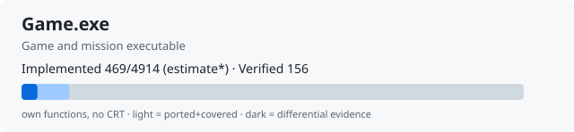
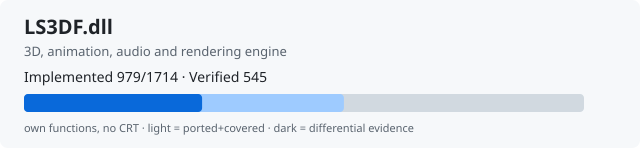
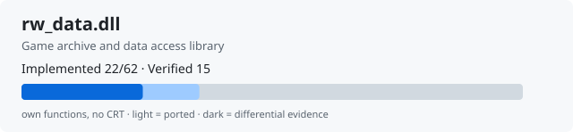
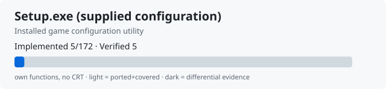

# Lost Heaven Reborn

An independent Rust reimplementation of *Mafia: The City of Lost Heaven*
(2002), using your legally obtained original PC assets. The goal is a playable
first mission from the original menu through completion. The campaign is not
playable; all six first-mission gates remain open.

Current state: MISE01 intake loads 3,183 scene objects, 293 actors, 39
scripts, the 13,857-node navigation graph and the 229-node road network
with zero retained owners after disposal. Mission execution, GameInit and
playable control remain open. See [coverage](COVERAGE.md),
[goals](docs/GOALS.md) and [progress](docs/PROGRESS.md); history lives in
`git log` on `rust-engine`.

<!-- rewrite-progress:start -->
## Rewrite progress

<p align="center">




</p>

The cards count each binary's own functions, without the C runtime linked into it. *Implemented* is how many of them have reviewed Rust source with tests. *Verified* is how many of those carry original-data or instruction-level differential evidence on top. There is no reccmp score here: byte-exact C++ matching does not apply to behavioral Rust ports. The function counts are exact but for `Game.exe`'s, an estimate until its code has been worked through. Static pseudocode retention, scoped ports, tests and original-runtime comparisons are independent measures and are never combined into one percentage.

| Binary | Implemented | Verified |
| --- | ---: | ---: |
| `Game.exe` | 172/4914* | 154 |
| `LS3DF.dll` | 145/1714 | 145 |
| `rw_data.dll` | 12/234 | 12 |
| `Setup.exe (supplied configuration)` | 5/172 | 5 |

*Estimate: frozen inventory union. PS2 `SLUS_206.71` supplies linker naming evidence only, without function coverage. Installer/bootstrap helpers (`DrvMgt.dll`, `INet.dll`, `IJoy.dll`, codecs) are unmeasured boundaries, not zero ports.

Script VM: 398 base + 121 entity opcodes decoded; executing frontier advances with the probe (USE_LIGHTCACHE (180); GAME_NIGHTMISSION (81) executes).

Gap: Oct 26-Nov 3 intake batches (actor factories, VM execution families, vehicle owners) are not yet audited into this overlay and count at zero here; their evidence lives in git log until audited. Extend this file per port-commit, never the frozen docs/progress.json.

<!-- rewrite-progress:end -->

## Build and run

Rust 1.99.1 and locked dependencies are required. Use your own legally
obtained original PC installation as the asset root.

```sh
./scripts/setup.sh
./scripts/test.sh
./scripts/run.sh --root /path/to/Mafia
./scripts/run.sh --root /path/to/Mafia --model models/taxi00.4ds --car-driving
./scripts/run.sh --root /path/to/Mafia --model models/TommyTAXIDRIVER.4ds --animation anims/breath01a.5ds --skeletal-animation
```

Driving: W/S accelerate/brake, A/D steer, Space handbrake, R reload.
Inspection: arrows and W/S move the camera. Menu New Game and `--mission mise01`
remain inspection entry points; authored first-mission gameplay is incomplete.
[Setup and run commands](docs/RUNNING.md).

## Engine Lab

Optional native scene/model browser with procedural scenes and presets.
Start without game files:

```sh
source scripts/common.sh
cargo run --locked -p lhr-engine --features engine-lab -- --synthetic --lab
```

[Controls, presets and captures](docs/RUNNING.md#engine-lab).

Code is MIT licensed. Game assets and trademarks belong to their owners.
