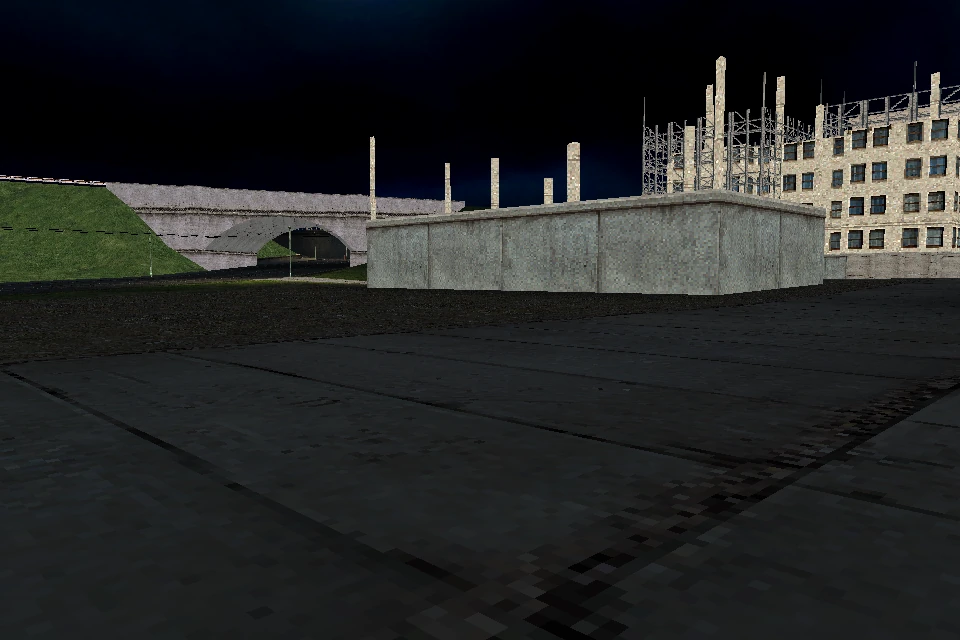
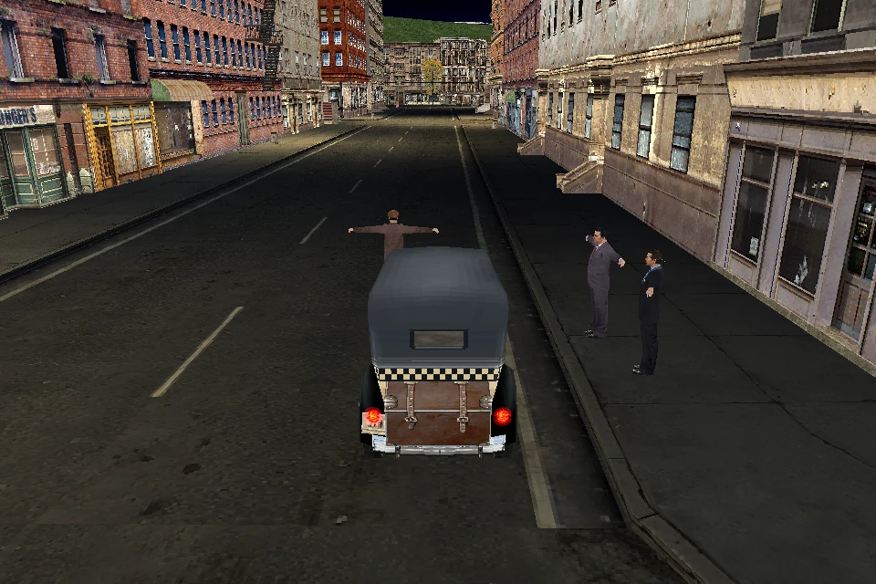

# Lost Heaven Reborn

An independent Rust reimplementation of *Mafia: The City of Lost Heaven*
(2002), using your legally obtained original PC assets. The goal is a playable
first mission from the original menu through completion. The campaign is not
playable; all six first-mission gates remain open.

The mission ActorWorld now owns genuine Car/Vehicle actors alongside Human,
Player and C_entity. Both original MISE01 cars complete Init and LoadData;
source intake reaches 3,183 objects and 38 actors before unsupported kind 20,
cursor 3,814,295. Explicit disposal closes every tracked owner, including the
car resources and independent frame records. GameInit and mission play remain open.

Replay intake reads the complete 107,352-byte record01a input into its real
owners; bounded first-actor binding matches controlled original instructions.
Actual mission playback still needs LoadDifferences and the later track pipeline.
Owned global Init/Done and CallSubroutine now use the actual CProgram.
Its 102 scalar and 39 no-payload parameter selectors are separate from execution
of DIM_ACT, DIM_FRM and COMMANDBLOCK. INTRO GlobalInit stops at FINDFRAME parameters.
The [new milestone](docs/implementation/2026-10-29-car-replay-programs.md)
records exact comparisons, source results and remaining dependencies.

The application also inspects original scenes, drives a car in standalone mode
and animates original models through their owned controller. Mission-controlled
human animation, recorded cutscenes and a playable first mission remain open.

[Build and run](docs/RUNNING.md) · [current evidence](docs/implementation/2026-10-29-car-replay-programs.md) ·
[coverage](COVERAGE.md) · [goals](docs/GOALS.md) · [dated history](docs/history/README.md).

[Latest reviewed integration: PRs #51–57](docs/implementation/2026-10-29-pr-integration.md)
adds world billboards, installed navigation intake and mission weather/sector
preparation. Original MISE01 navigation loads 13,857 nodes and 67,260 links;
pathfinding and authored mission execution remain open.

<details>
<summary>Static research and accepted scoped-port dashboard</summary>

<!-- generated-function-progress:start -->
As of 2026-10-25 · snapshot `RUST-SCOPED-PORTS-20261025-47`.

<p align="center"></p>

| Original binary | Static retained pseudocode | Denominator basis | Full contracts | Full Rust ports | Differential runtime verified |
| --- | ---: | --- | ---: | ---: | ---: |
| Game.exe | 4784 / 4,914 (97.35%) | Explicit profile union | N/A | N/A | N/A |
| rw_data.dll | 176 / 234 (75.21%) | Explicit profile union | N/A | N/A | N/A |
| LS3DF.dll | 1555 / 1,714 (90.72%) | Explicit profile union | N/A | N/A | N/A |
| Setup.exe (supplied configuration) | 172 / 172 (100.00%) | In-image non-thunk procedures | N/A | N/A | N/A |

Strict full-system gate: **0/12**. Binary-level static counts use the named denominator basis and do not combine into a game-completion percentage. Unknown denominators remain N/A. 1 supplied configuration Setup inventory uses 172 in-image non-thunk procedures. Separately, archive installer bootstrap static inventory: **376 / 376 (100.00%)**; this distribution target is not combined with engine-library counts. The campaign is not playable.

Accepted scoped Rust ports: **311 entries across 114 reviewed contracts**. These remain separate from retained pseudocode and whole-function counts.

Regenerate locally with `python3 scripts/progress.py --write`; verify without writes with `python3 scripts/progress.py --check`. Versioned snapshots are retained in `docs/progress.json`.
Milestone history and scoped implementation evidence are in [docs/PROGRESS.md](docs/PROGRESS.md).
Supplied binary catalog (file identities; independent measures):

| Binary | Platform | Variant | Role | Static retained pseudocode | Scoped Rust entries |
| --- | --- | --- | --- | ---: | ---: |
| DrvMgt.dll | PC | Installed game | Driver-management helper, exact runtime use unresolved | N/A | 0 |
| Game.exe | PC | Installed game | Game and mission executable | 4784 / 4,914 (97.35%) | 149 |
| IJoy.dll | PC | Installed game | DirectInput joystick wrapper | N/A | 0 |
| INet.dll | PC | Installed game | Network helper, exact runtime use unresolved | N/A | 0 |
| LS3DF.dll | PC | Installed game | 3D, animation, audio and rendering engine | 1555 / 1,714 (90.72%) | 145 |
| Setup.exe (supplied configuration) | PC | Installed game | Installed game configuration utility | 172 / 172 (100.00%) | 5 |
| binkw32.dll | PC | Installed game | Bink video codec boundary | N/A | 0 |
| ogg.dll | PC | Installed game | Ogg container library boundary | N/A | 0 |
| rw_data.dll | PC | Installed game | Game archive and data access library | 176 / 234 (75.21%) | 12 |
| vorbis.dll | PC | Installed game | Vorbis codec library boundary | N/A | 0 |
| vorbisfile.dll | PC | Installed game | Vorbis stream and file library boundary | N/A | 0 |
| Setup.exe (archive installer bootstrap) | PC | Distribution archive | Distribution installer bootstrap | 376 / 376 (100.00%) | 0 |
| SLUS_206.71 | PS2 | PS2 disc executable | PS2 game executable with retained linker symbols | N/A | 0 |
| CDVDSTM.IRX | PS2 | PS2 disc IOP module | CD and DVD streaming support module | N/A | 0 |
| IOPRP271.IMG | PS2 | PS2 disc support image | IOP reboot and support image, container contents unmeasured | N/A | 0 |
| LIBSD.IRX | PS2 | PS2 disc IOP module | Sound support module | N/A | 0 |
| MCMAN.IRX | PS2 | PS2 disc IOP module | Memory-card management module | N/A | 0 |
| MCSERV.IRX | PS2 | PS2 disc IOP module | Memory-card service module | N/A | 0 |
| MTAPMAN.IRX | PS2 | PS2 disc IOP module | Multitap support module | N/A | 0 |
| PADMAN.IRX | PS2 | PS2 disc IOP module | Controller support module | N/A | 0 |
| SDRDRV.IRX | PS2 | PS2 disc IOP module | Sound driver module | N/A | 0 |
| SIO2MAN.IRX | PS2 | PS2 disc IOP module | SIO2 support module | N/A | 0 |
| SOUND.IRX | PS2 | PS2 disc IOP module | Game-distributed sound module | N/A | 0 |
| SOUND2.IRX | PS2 | PS2 disc IOP module | Game-distributed sound module | N/A | 0 |
| SOUND_M.IRX | PS2 | PS2 disc IOP module | Game-distributed sound module | N/A | 0 |

N/A means no measured static procedure ratio. PS2 linker symbol research supplies naming evidence, not static procedure coverage. Scoped entries are absolute reviewed counts joined by binary SHA-256; zero is not 0% coverage. Whole-function and differential runtime coverage remain unmeasured (N/A).
<!-- generated-function-progress:end -->

</details>

## Build and run

Rust 1.99.1 and locked dependencies are required. Linux/Vulkan has been
exercised; native Windows/Vulkan and macOS/Metal have not been run. Use your
own legally obtained original PC installation as the asset root.

```sh
./scripts/setup.sh
./scripts/test.sh
./scripts/run.sh --root /path/to/Mafia
./scripts/run.sh --root /path/to/Mafia --model models/taxi00.4ds --car-driving
./scripts/run.sh --root /path/to/Mafia --model models/TommyTAXIDRIVER.4ds --animation anims/breath01a.5ds --skeletal-animation
```

Driving: W/S accelerate/brake, A/D steer, Space handbrake, R reload.
Inspection: arrows and W/S move the camera. Menu New Game and `--mission mise01`
remain inspection entry points; authored first-mission gameplay is incomplete.
[Linux, Windows and macOS setup and run commands](docs/RUNNING.md) include native
prerequisites, captures and platform validation status.
[Historical commands and validation](docs/history/2026-10-25-readme-narrative.md) remain available.

## Engine Lab

The optional native Lab has a scene/model browser, four public procedural scenes,
lighting and weather previews, orbit/pan cameras and bookmarks, model transforms,
draw isolation, vehicle inputs and portable presets. Materials and Diagnostics
inspect actual material clocks, mission owners, load frontiers and retained
cleanup without advancing their state. Start without game files:

```sh
source scripts/common.sh
cargo run --locked -p lhr-engine --features engine-lab -- --synthetic --lab
```

Add `--root /path/to/Mafia` to browse your installation. Lighting, fog and
precipitation are optional host previews; they do not implement original weather
or mission gameplay. [Controls, presets and captures](docs/RUNNING.md#engine-lab).
[Native Lab preview](docs/screenshots/2026-10-28/engine-lab.png) ·
[actual mission owners](docs/screenshots/2026-10-27-engine-lab-mission-owners.webp).

## Actual Rust captures

Latest car/replay/program checkpoint: [MISE01 source view](docs/screenshots/2026-10-29-car-replay/mise01-source.webp)
and [source/image evidence](docs/screenshots/2026-10-29-car-replay/evidence.json).
Fresh Linux/software-Vulkan capture exits 0 with clean canonical disposal.
The static camera view does not show the new car actors or authored gameplay.
Validation passes 1,966 all-feature Rust tests and 106 Python tests.
[Implementation and exact limits](docs/implementation/2026-10-29-car-replay-programs.md).
Earlier captures below retain their own scope.




24 actual GPU samples at 100 ms intervals, source times 0–2,300 ms, 512 × 512,
102 KiB. The preview repeats this sampled segment; it is an explicitly selected
original animation, without mission scheduling or image interpolation.

| Original bind pose | Actual model-owned animation at 1,746 ms |
| --- | --- |
|  |  |

Fresh original-resource animation checks cover Tommy, Paulie and Sam, with
actual changed vertices and GPU pixels. [Implementation and validation](docs/implementation/2026-10-29-animation-runtime.md)
record 1,863 all-feature Rust tests, the exact supported animation domain and
remaining actor/replay/script dependencies. These are model diagnostics;
the original first-mission startup is not running yet.



Fresh 2026-10-29 captures: [MISE01 inspection](docs/screenshots/2026-10-29/mise01.webp),
[menu inspection](docs/screenshots/2026-10-29/menu.webp) and
[image hashes](docs/screenshots/2026-10-29/evidence.json).
[Executed checks and exact limits](docs/implementation/2026-10-29-pr-integration.md)
include 1,833 all-feature Rust tests, actual driving controls and zero-owner
taxi cleanup. MISE01 still stops at actor kind 27; New Game stops during INTRO
and retains interrupted cache cleanup. These are inspection and standalone
driving results; authored mission completion remains open.
[MRPH evidence](docs/implementation/parity-continuation.md) and earlier media
retain their dated scope in [capture history](docs/screenshots/README.md).

## Research and assets

REA/Ghidra and actual PS2 symbols guide reconstruction; scoped contracts,
static pseudocode and complete-system validation are separate measures.
Original data, executables and private research stay outside Git; public tests
use synthetic fixtures. [Reference audit](docs/REFERENCE_PROJECTS.md) ·
[optional enhanced assets](docs/ASSET_ENHANCEMENT.md) · [third-party notices](THIRD_PARTY_NOTICES.md).

Code is MIT licensed. Game assets and trademarks belong to their owners.
