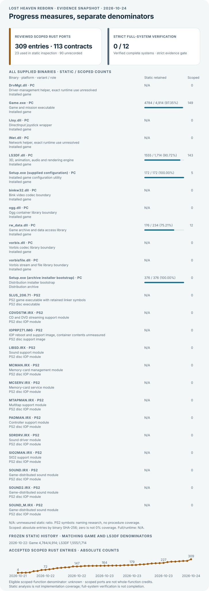
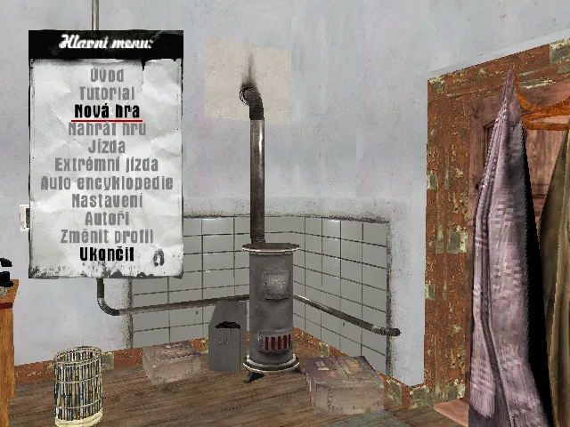
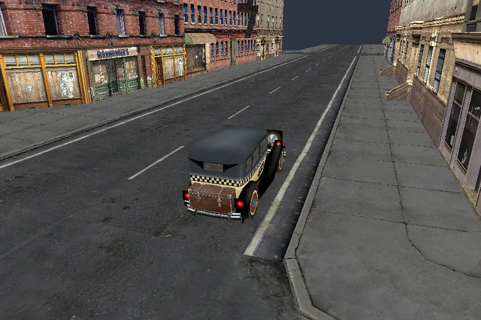
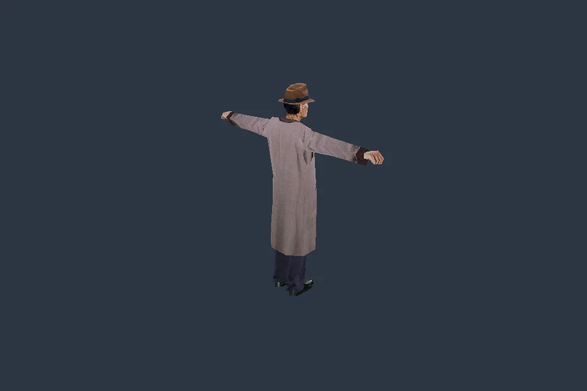
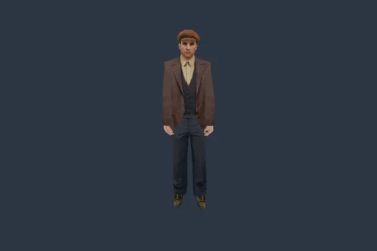

# Lost Heaven Reborn

<!-- generated-function-progress:start -->
As of 2026-10-22 · snapshot `RUST-SCOPED-PORTS-20261022-20`.

<p align="center"></p>

| Original binary | Static retained pseudocode | Denominator basis | Full contracts | Full Rust ports | Differential runtime verified |
| --- | ---: | --- | ---: | ---: | ---: |
| Game.exe | 4784 / 4,914 (97.35%) | Explicit profile union | N/A | N/A | N/A |
| rw_data.dll | 176 / 234 (75.21%) | Explicit profile union | N/A | N/A | N/A |
| LS3DF.dll | 1555 / 1,714 (90.72%) | Explicit profile union | N/A | N/A | N/A |
| Setup.exe (supplied configuration) | 172 / 172 (100.00%) | In-image non-thunk procedures | N/A | N/A | N/A |

Strict full-system gate: **0/12**. Binary-level static counts use the named denominator basis and do not combine into a game-completion percentage. Unknown denominators remain N/A. 1 supplied configuration Setup inventory uses 172 in-image non-thunk procedures. Separately, archive installer bootstrap static inventory: **376 / 376 (100.00%)**; this distribution target is not combined with engine-library counts. The campaign is not playable.

Accepted scoped Rust ports: **161 entries across 51 reviewed contracts**. These remain separate from retained pseudocode and whole-function counts.

Regenerate locally with `python3 scripts/progress.py --write`; verify without writes with `python3 scripts/progress.py --check`. Versioned snapshots are retained in `docs/progress.json`.
Milestone history and scoped implementation evidence are in [docs/PROGRESS.md](docs/PROGRESS.md).
<!-- generated-function-progress:end -->

Static percentages retain raw analyzer denominators, including external import rows. The audited in-image cohorts now have output for 4,784/4,784 Game, 1,555/1,555 LS3DF and 176/176 rw_data entries. These are recognized cohorts, not exhaustive function discovery or completed Rust rewrites; 491 pinned mafia-re LS3DF addresses still need exact inventory correspondence. Scoped ports, warnings and runtime validation remain separate, with history preserved.

An independent Rust reimplementation of the Mafia: The City of Lost Heaven (2002) engine and game. The goal is an engine that runs the original game's models, animations and campaign from a user's legally obtained PC installation. Current functionality includes the Czech PC menu, bounded scene/model loading, an owned frame/Joint/Target hierarchy, and sequential skeletal animation through recovered controller, clock and dispatch paths. The campaign is not playable. No runtime game data is included.

The animation path binds original track names, advances one live controller slot, evaluates position and bounded linear/spherical rotation, updates Target and morph state, and uploads CPU-skinned first-LOD geometry. Controller ownership and controls cover eight slots; blended evaluation, scale/note channels, full animation-resource ownership and actor/mission integration remain open. Unsupported inputs fail explicitly. Original models and clips are regression fixtures for this general implementation.

Standalone object/mesh/material ownership now includes bounded actual managed-record creation and existing texture/string cleanup. Prepared-owner filename/format derivation, allocation rejection, registry publication and later removal compose through explicit storage backends. Full texture Create, Request/worker/upload, pool shutdown, derived LODs, loaded/GPU adapters and scene teardown remain open; no application or new rendered/interactive validation is claimed.

Ownership code uses `lhr_engine::ls3df::{c_str, itexture, i3d_object, texture_manager}`. These logical original-library modules add no DLL or Cargo package; see the [package and name mapping](docs/REFERENCE_PROJECTS.md#rust-organization-and-original-names).

The immediate goal is **the playable first mission, from the original menu through mission completion**, alongside function-by-function library parity with mafia-re. See the [acceptance gates and dependency order](docs/GOALS.md). PS2 symbol names guide reconstruction; PC behavior and platform differences require original-binary verification.

| Czech PC menu in Rust | MISE01 static inspection in Rust |
| --- | --- |
|  |  |

[Dated screenshot history](docs/screenshots/README.md) · 176 KiB total for these two previews. The mission view is not playable.



Actual Rust capture using original geometry and textures; first LOD, static pose and inspection lighting. [Evidence and reproduction](docs/screenshots/README.md#2026-10-22--original-skinned-character).



Actual 1,000 ms pose sample, original geometry and textures, inspected through X11. Preview: 640 × 427, 2.9 KiB. [Reproduction and limits](docs/screenshots/README.md#2026-10-22--original-tommy-skeletal-pose).

## Build and run

Requires Rust 1.99.1, installed by the setup script. Linux uses wgpu with Vulkan; macOS is intended to use Metal. Dependencies are pinned in `Cargo.lock`.

```sh
./scripts/setup.sh
./scripts/test.sh
./scripts/run.sh --synthetic
```

Build the native engine binary with `cargo build --locked -p lhr-engine` from the repository root. These commands use the user's game installation directly:

```sh
./scripts/run.sh --root /path/to/Mafia
./scripts/run.sh --root /path/to/Mafia --mission mise01
./scripts/run.sh --root /path/to/Mafia --model models/4build81.4ds
./scripts/run.sh --root /path/to/Mafia --model models/civil02.4ds
./scripts/run.sh --root /path/to/Mafia --model models/TommyTAXIDRIVER.4ds --animation anims/breath01a.5ds --skeletal-animation
./scripts/run.sh --root /path/to/Mafia --model models/TommyTAXIDRIVER.4ds --animation anims/breath01a.5ds --sample-animation-ms 1000
./scripts/run.sh --root /path/to/Mafia --model models/sipka1.4ds --animation models/sipka1.5ds
```

The first command opens the Rust-rendered original menu. Up/Down and Enter select options; only New Game and Exit work, and there is no profile chooser. New Game switches to a static intro scene; Escape switches to the bounded MISE01 spawn-neighborhood inspection. This temporary inspection path does not play the original video/cinematic or execute missions or gameplay. Add `--headless --capture /tmp/scene.png` to either inspection command for a one-frame GPU capture, or `--frames N` to bound a window run. Camera inspection uses arrow keys and W/S. See [coverage](COVERAGE.md) for exact evidence and limits.

Standalone static `--model` loading now builds an owned mesh/dummy hierarchy using recovered common LS3DF fields, parent links, reference transitions and guarded original transforms. `4build81.4ds` exercises three meshes and one dummy. Unsupported frame types, world-space visuals, reflective materials and unverified numeric paths report errors. This route does not establish native world streaming or original lighting/material parity. The MISE01 neighborhood remains a separate static inspection path.

Standalone models use the owned original hierarchy and checked first-LOD skin/morph pose. Earlier skin intake admits 80 of 82 selected paths (37,948 vertices); two remain explicit numeric-domain failures. Separate composed comparisons cover `civil02` and the actual `TommyTAXIDRIVER` model. Connecting recovered ownership to loaded visuals and the GPU backend, full texture creation and Request/worker/upload, pool shutdown and original lighting remain open; the inspection renderer does not use recovered normals for lighting.

`--skeletal-animation` runs sequential position/rotation playback for a supported model/animation pair. It explicitly requests slot 0, unit weight and loop mode; original game animation selection is not implemented. Windowed playback uses the recovered clock and dispatch path. Add `--headless --animation-steps 25 --capture /tmp/animation.png` for 25 controlled 16 ms steps. Bounds, deformation and rendering are requested by the inspection adapter; this does not establish original renderer scheduling. Spherical rotation admits angles through 1.5 radians only where checked numeric intervals give an unambiguous original float result. Other domains, multi-slot blending, scale and notes fail explicitly.

`--sample-animation-ms` retains independent position/rotation pose evaluation at the supplied time, followed by Target updates and skinning. Original `breath01a` samples at 0, 40, 200, 1000 and 5240 ms remain regression evidence. This option excludes sequential playback and `--animation-steps`.

The `sipka1` command without a sample time retains the earlier single-root position playback path through the recovered clock, model and interpolator. Add `--headless --animation-steps 25 --capture /tmp/animation.png` for 25 controlled 16 ms steps. Captures at 0/25/50 steps verify movement and exact return; inspection camera, handedness, materials and rasterization remain separate from original presentation.

`setup.sh --graphics` prepares the Linux software Vulkan tools used for development captures. `scripts/test.sh` checks formatting, compilation, tests, Clippy, REA wrappers and generated progress. On Linux x86_64, X11 input has been checked through menu, static INTRO and the MISE01 neighborhood, including orbit and reload. An Apple arm64 cargo check passes, but macOS linking and Metal runtime have not been tested. iOS is a future compatibility target. The original game's executable and REA are not gameplay runtime dependencies.

## Reverse engineering and assets

REA with Ghidra is the required analysis path for engine behavior. Evidenced original function/type names are preserved, with Rust naming conventions; descriptive working names remain explicitly distinct from recovered symbols. Keep original executables, installations, extracted or converted assets, analysis databases, decompiler output, credentials and private URLs outside Git. Public tests use synthetic fixtures. The reader supports selected PC DTA archives and bounded model, scene, menu and script-data formats; archive audio and checksum verification remain unsupported. Full city simulation, mission execution and campaign play are not implemented. Use a trusted, stable installation tree. PS2 material is used for research and comparison.

Project code is MIT licensed. Game assets and trademarks belong to their respective owners. See [third-party notices](THIRD_PARTY_NOTICES.md), the [mafia-re/MafiaUnity reference audit and PS2 symbol crosscheck](docs/REFERENCE_PROJECTS.md), and the [asset inventory and optional graphics assessment](docs/ASSET_ENHANCEMENT.md).
