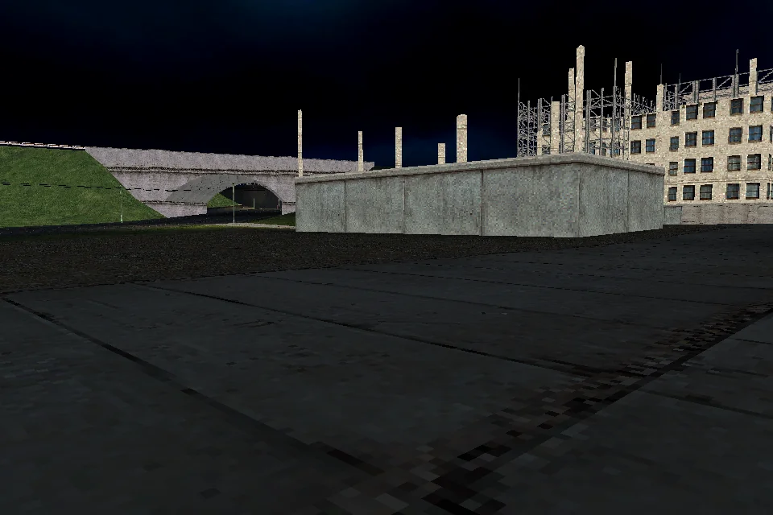

# Lost Heaven Reborn

An independent Rust reimplementation of *Mafia: The City of Lost Heaven*
(2002), using your legally obtained original PC assets. The goal is a playable
first mission from the original menu through completion. The campaign is not
playable; all six first-mission gates remain open.

The current Rust application can inspect the menu and owned scene, render an
actual sky and road view, and drive a car in a standalone mode. Its MISE01
diagnostic loaded all 3,183 scene objects and reached the actor-dispatch
boundary at cursor 3,794,014. A snapshot produced 267 draws, including five
real zapad sky passes, and closed cleanly. Actor registration, scripts and
authored mission play remain to be connected.

[Build and run](docs/RUNNING.md) · [current evidence](docs/implementation/mafia-re-remediation.md) ·
[coverage](COVERAGE.md) · [goals](docs/GOALS.md) · [dated history](docs/history/README.md).

<details>
<summary>Static research and accepted scoped-port dashboard</summary>

<!-- generated-function-progress:start -->
As of 2026-10-25 · snapshot `RUST-SCOPED-PORTS-20261025-47`.

<p align="center"></p>

| Original binary | Static retained pseudocode | Denominator basis | Full contracts | Full Rust ports | Differential runtime verified |
| --- | ---: | --- | ---: | ---: | ---: |
| Game.exe | 4784 / 4,914 (97.35%) | Explicit profile union | N/A | N/A | N/A |
| rw_data.dll | 176 / 234 (75.21%) | Explicit profile union | N/A | N/A | N/A |
| LS3DF.dll | 1555 / 1,714 (90.72%) | Explicit profile union | N/A | N/A | N/A |
| Setup.exe (supplied configuration) | 172 / 172 (100.00%) | In-image non-thunk procedures | N/A | N/A | N/A |

Strict full-system gate: **0/12**. Binary-level static counts use the named denominator basis and do not combine into a game-completion percentage. Unknown denominators remain N/A. 1 supplied configuration Setup inventory uses 172 in-image non-thunk procedures. Separately, archive installer bootstrap static inventory: **376 / 376 (100.00%)**; this distribution target is not combined with engine-library counts. The campaign is not playable.

Accepted scoped Rust ports: **311 entries across 114 reviewed contracts**. These remain separate from retained pseudocode and whole-function counts.

Regenerate locally with `python3 scripts/progress.py --write`; verify without writes with `python3 scripts/progress.py --check`. Versioned snapshots are retained in `docs/progress.json`.
Milestone history and scoped implementation evidence are in [docs/PROGRESS.md](docs/PROGRESS.md).
Supplied binary catalog (file identities; independent measures):

| Binary | Platform | Variant | Role | Static retained pseudocode | Scoped Rust entries |
| --- | --- | --- | --- | ---: | ---: |
| DrvMgt.dll | PC | Installed game | Driver-management helper, exact runtime use unresolved | N/A | 0 |
| Game.exe | PC | Installed game | Game and mission executable | 4784 / 4,914 (97.35%) | 149 |
| IJoy.dll | PC | Installed game | DirectInput joystick wrapper | N/A | 0 |
| INet.dll | PC | Installed game | Network helper, exact runtime use unresolved | N/A | 0 |
| LS3DF.dll | PC | Installed game | 3D, animation, audio and rendering engine | 1555 / 1,714 (90.72%) | 145 |
| Setup.exe (supplied configuration) | PC | Installed game | Installed game configuration utility | 172 / 172 (100.00%) | 5 |
| binkw32.dll | PC | Installed game | Bink video codec boundary | N/A | 0 |
| ogg.dll | PC | Installed game | Ogg container library boundary | N/A | 0 |
| rw_data.dll | PC | Installed game | Game archive and data access library | 176 / 234 (75.21%) | 12 |
| vorbis.dll | PC | Installed game | Vorbis codec library boundary | N/A | 0 |
| vorbisfile.dll | PC | Installed game | Vorbis stream and file library boundary | N/A | 0 |
| Setup.exe (archive installer bootstrap) | PC | Distribution archive | Distribution installer bootstrap | 376 / 376 (100.00%) | 0 |
| SLUS_206.71 | PS2 | PS2 disc executable | PS2 game executable with retained linker symbols | N/A | 0 |
| CDVDSTM.IRX | PS2 | PS2 disc IOP module | CD and DVD streaming support module | N/A | 0 |
| IOPRP271.IMG | PS2 | PS2 disc support image | IOP reboot and support image, container contents unmeasured | N/A | 0 |
| LIBSD.IRX | PS2 | PS2 disc IOP module | Sound support module | N/A | 0 |
| MCMAN.IRX | PS2 | PS2 disc IOP module | Memory-card management module | N/A | 0 |
| MCSERV.IRX | PS2 | PS2 disc IOP module | Memory-card service module | N/A | 0 |
| MTAPMAN.IRX | PS2 | PS2 disc IOP module | Multitap support module | N/A | 0 |
| PADMAN.IRX | PS2 | PS2 disc IOP module | Controller support module | N/A | 0 |
| SDRDRV.IRX | PS2 | PS2 disc IOP module | Sound driver module | N/A | 0 |
| SIO2MAN.IRX | PS2 | PS2 disc IOP module | SIO2 support module | N/A | 0 |
| SOUND.IRX | PS2 | PS2 disc IOP module | Game-distributed sound module | N/A | 0 |
| SOUND2.IRX | PS2 | PS2 disc IOP module | Game-distributed sound module | N/A | 0 |
| SOUND_M.IRX | PS2 | PS2 disc IOP module | Game-distributed sound module | N/A | 0 |

N/A means no measured static procedure ratio. PS2 linker symbol research supplies naming evidence, not static procedure coverage. Scoped entries are absolute reviewed counts joined by binary SHA-256; zero is not 0% coverage. Whole-function and differential runtime coverage remain unmeasured (N/A).
<!-- generated-function-progress:end -->

</details>

## Build and run

Rust 1.99.1 and locked dependencies are required. Linux/Vulkan has been
exercised; native Windows/Vulkan and macOS/Metal have not been run. Use your
own legally obtained original PC installation as the asset root.

```sh
./scripts/setup.sh
./scripts/test.sh
./scripts/run.sh --root /path/to/Mafia
./scripts/run.sh --root /path/to/Mafia --model models/taxi00.4ds --car-driving
./scripts/run.sh --root /path/to/Mafia --model models/TommyTAXIDRIVER.4ds --animation anims/breath01a.5ds --skeletal-animation
```

Driving: W/S accelerate/brake, A/D steer, Space handbrake, R reload.
Inspection: arrows and W/S move the camera. Menu New Game and `--mission mise01`
remain inspection entry points; authored first-mission gameplay is incomplete.
[Linux, Windows and macOS setup and run commands](docs/RUNNING.md) include native
prerequisites, captures and platform validation status.
[Historical commands and validation](docs/history/2026-10-25-readme-narrative.md) remain available.

## Actual Rust captures



All 3,183 scene objects are loaded in this inspection view; actor dispatch
is the next boundary. [Menu sky](docs/screenshots/2026-10-26-menu-sky.webp) ·
[Engine Lab](docs/screenshots/2026-10-26-engine-lab.webp) · [source, checks and limits](docs/implementation/mafia-re-remediation.md).
Earlier media and their dated scope remain in [capture history](docs/screenshots/README.md).

## Research and assets

REA/Ghidra and actual PS2 symbols guide reconstruction; scoped contracts,
static pseudocode and complete-system validation are separate measures.
Original data, executables and private research stay outside Git; public tests
use synthetic fixtures. [Reference audit](docs/REFERENCE_PROJECTS.md) ·
[optional enhanced assets](docs/ASSET_ENHANCEMENT.md) · [third-party notices](THIRD_PARTY_NOTICES.md).

Code is MIT licensed. Game assets and trademarks belong to their owners.
