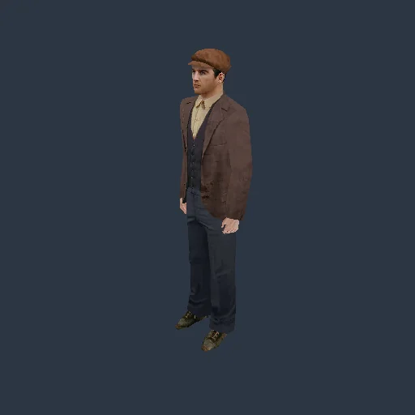
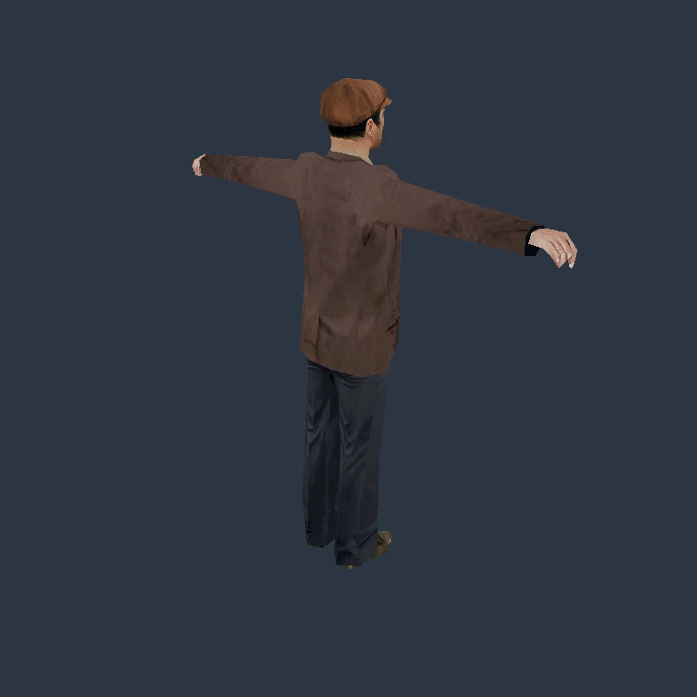
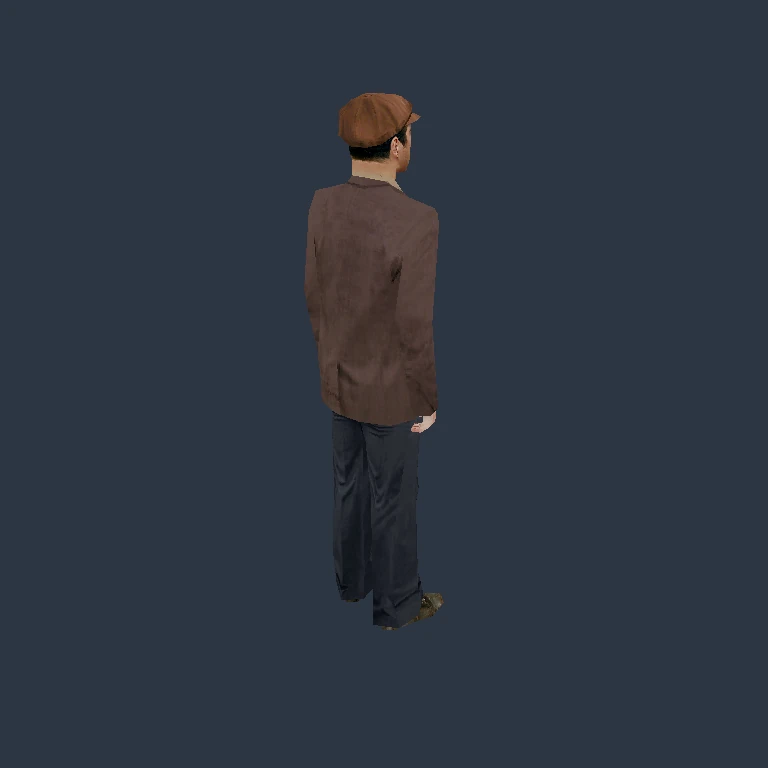

# Model-owned animation and first-mission dependencies

Engine revision: `b3b6b67d6eea3d025b42618c349b8929a077d25c`.
The campaign and all six [first-mission gates](../GOALS.md) remain open.

## What changed

`ModelArena` now owns the actual `IPolSet` controller and shared animation
resources. SetAnimation allocates only when absent, publishes the owner before
delegation and binds tracks against live original local frame names. Resource
identity and mutable default options remain shared; failure preserves completed
effects. Close destroys the controller before the model's frames.

Model Tick borrows that same controller in place. Its nonnull/nonempty guard
precedes interpolation and the current model Update. Bound track/destination
identities drive actual frame writes; selected-LOD rendering refreshes the
existing skin from live joints. Position/rotation support one unit-weight
contributing slot per evaluator. Scale, multiple contributing slots and event
callbacks stop at their reached phase, preserving clocks and earlier writes.
A host-only interruption guard prevents replay or presentation of an old skin
as a completed pose; existing terminal pose errors remain intact.

The separate `SharedAnimationModel` bridge also borrows the existing arena,
without cloning the model or pose owner. It remains an explicitly selected host
preview and refuses a model that already has an original controller.

Checked Normalize now admits small normal quaternion components while retaining
the supported per-operation PC24 arithmetic domain. This removes INTRO's old
numeric frontier. Six original LENS parameters now live on their actual frame;
scene loading and duplication preserve observed ordering and the intensity-copy
quirk. This loads parameters, without claiming a complete lensflare renderer.

## Actual original-resource rendering

This 104,332-byte animated WebP contains 24 actual 512 × 512 GPU frames,
source times 0–2,300 ms at sequential 100 ms Tick intervals. Every original PNG
was checked against its recorded renderer RGBA hash. No frames were generated
or interpolated. The fixed host camera faces the model. Each encoded frame
lasts 100 ms (2,400 ms total); the container repeats the sampled segment,
without demonstrating the complete original clip loop or mission scheduling.

| Original bind pose | Actual owned Tick at 1,746 ms |
| --- | --- |
|  |  |

The diagnostic explicitly supplies `breath01a.5ds` to each model, resource mode
2, slot 0, weight 1, model options 0 and host allocation dirty=false. It executes
SetAnimation, Tick(0), SetAnimTime(0), then Tick(1746), retaining the actual
controller and model. A fixed camera is fitted at time zero. These unlit
768 × 768 software-Vulkan captures are actual engine output.

| Original model | Frames / draws | Changed vertex coordinate words, 0→1746 ms | Changed pixels, 0→1746 ms |
| --- | ---: | ---: | ---: |
| TommyTAXIDRIVER | 24 / 6 | 15,516 | 43,817 |
| Paulie | 24 / 5 | 12,270 | 43,367 |
| Sam | 23 / 5 | 11,730 | 44,564 |

All three also change from bind pose at Tick(0), have 20 active evaluators, and
match all twelve vertex/RGBA hashes from the earlier explicit host bridge.
That agreement is a Rust-path regression, not comparison with the original
renderer. [Paulie](../screenshots/2026-10-29-animation/paulie-animated.webp),
[Sam](../screenshots/2026-10-29-animation/sam-animated.webp) and
[sanitized capture evidence](../screenshots/2026-10-29-animation/evidence.json).

Each model Close is followed by explicit existing buffer-manager reclamation:
graphics, textures and allocations reach zero. The empty root remains until
arena drop. All diagnostic processes exited normally; libraries and source
hashes remained unchanged. Original assets and raw captures remain private.

This does not choose animations for mission actors or run C_human/GameInit,
SetAnim, recordings, scene scheduling or objectives. The existing public
`--skeletal-animation` command is a separate host preview path.

## Validation

Both independent source-review rounds passed for the shared bridge, controller
producer, owned Tick, Normalize and LENS changes. Reviews checked native evidence,
live ownership, reached effect/error order and stated behavioral limits.

On the pinned revision, `scripts/test.sh` passed: 1,839 Rust tests, 106 Python
tests, formatting, check, Clippy and generated progress checks. The all-feature
run including ignored GPU tests passed 1,863 Rust tests, zero ignored; its
counts overlap the default run. All-feature Clippy and the default application
build passed. Source was clean and unchanged throughout the combined gate.

Controlled execution of the original PC instructions is separate from running
the original game:

- Normalize: 74 admitted cases / 296 component words match original results.
- Controller producer and controls: 15 snapshots / 345 normalized state words
  match retained original observations when rerun against the final sealed
  engine. Pointer identities are mapped to resource/member ordinals; resource
  reference totals are not compared.
- Owned Tick: 12 snapshots / 264 normalized state words match unchanged
  original code, including slot 0 and slot 7, null/empty guards, clocks, local
  position/quaternion and queried world position. A per-call original Update
  observer is compared with the Rust successful-body result, not graph dirty
  traversal counts. Both Rust probe optimization profiles link the same sealed
  default debug engine; this is not a release-engine comparison.

An independent review rechecked every compared word and all twenty original
function-body hashes. The wider-angle initial fixture exceeded the existing
rotation sampler domain and remains unsupported. An earlier attempt incorrectly
compared different Update counters; it is preserved alongside the corrected,
independently frozen observable mapping. No mismatching field was ignored.

These are bounded comparisons, not complete function or floating-domain parity.
The original game executable was not launched. Native macOS/Metal, Windows and
ARM64 numerical behavior have not been exercised in this batch. No fresh
interactive first-mission verification occurred.

## Original loading still stops honestly

Fresh `--mission-load-probe --probe-model-dir Models` runs of the sealed final
application all exit **1** at the following explicit boundaries:

| Scene | Completed objects | Frontier | Disposal |
| --- | ---: | --- | --- |
| INTRO | 358 | Actor kind 2, cursor 429,872 | Complete; tracked owners zero |
| MISE01 | 3,183, with 27 actors reached | Actor kind 27, cursor 3,795,696 | Complete; tracked owners zero |
| 00menu | 69 | Animated model, cursor 466,049 | Interrupted model cache |

Menu cleanup retains 24 frames, 11 cache allocations, 3 graphics, 22 textures
and 52 visual allocations until process exit. A successful diagnostic runner
means evidence was collected, not successful scene admission.

## Next dependencies

The original first-mission startup hides the characters, selects its CHG/REP
recording, waits and restores the original taxi occupancy. It does not author a
generic standing idle for every loaded human. Human GameInit initializes the
animation machine; later state transitions and SetAnim choose the actual
resource and model calls. Their static evidence is recovered, but the complete
live owners and scheduling are not implemented.

The next actor dependency is actual Human/Player construction, Init, version-6
LoadData and destruction for kind 2. Kind 27 is `C_entity`, with its own embedded
program owner and ordered Human/program loading. Both need genuine dependencies
rather than substitute actor objects. Recording playback, production parameter
decoding/VM execution, vehicle attachment, player input/cameras and original
mission objectives remain open.

The menu's companion animation contains scale as well as position. General
scale evaluation, AnimationSet.Open, ordered LoadHierarchy integration and cache
duplication that rebinds the shared slot-0 resource are required. Ignoring the
animation-count byte or assigning an arbitrary pose does not complete loading.

## Traceability and coverage

PC LS3DF SHA-256:
`e211c85009440d6c032f2074d79184f074a9a046574648745c2594b4cef178a6`.
Relevant canonical RVAs: Normalize `0x30140`, SetAnimation `0x337b0`, Model Tick
`0x34010`, IPolSet Tick `0x1e470`, evaluator `0x1d320`, LENS constructor `0x9520`,
hierarchy/animation loading `0x603e0` / `0x60840` / `0x61800`.

PC Game SHA-256:
`08398317c8dc423dbb3e559f0ba53c207a8eaf5bcefa915dff83b7a86416ab27`.
Mappings include Human Init RVA `0x16f350`, Human GameInit `0x174bd0` and
C_entity constructor `0x1071a0`. PS2 linker/debug evidence supplies naming
cross-checks; no PS2 execution equivalence is claimed here. LENS duplication
lacks a confirmed provider function boundary and receives no function credit.

Detailed proprietary analysis, decompiler output, original binaries and databases
remain private. Accepted scoped totals stay **311 entries / 114 contracts**;
strict full-system verification stays **0/12**, whole-function coverage **N/A**.
