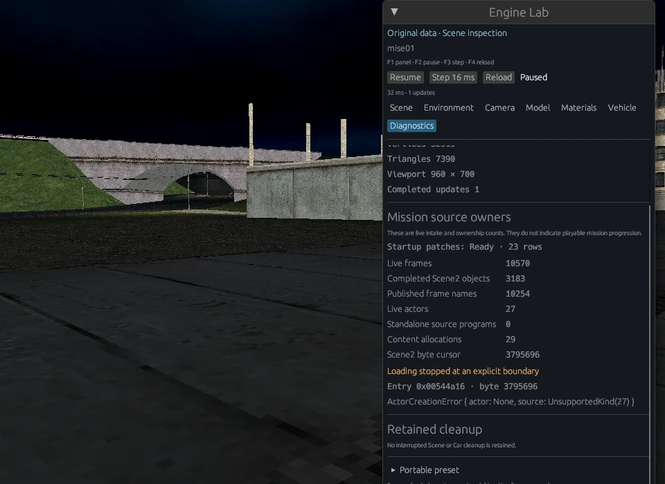
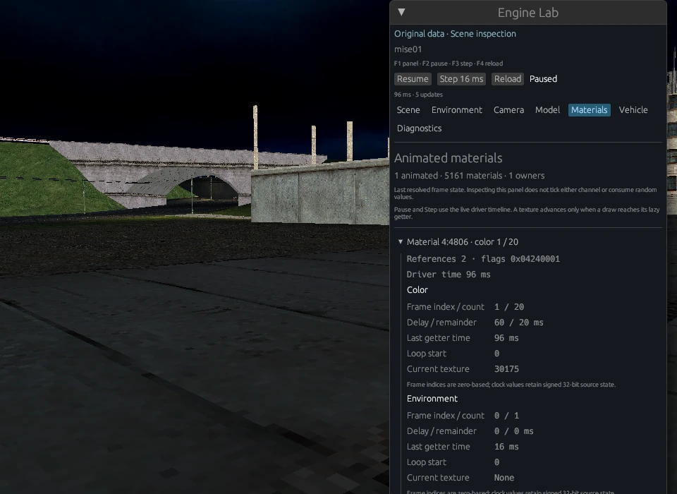
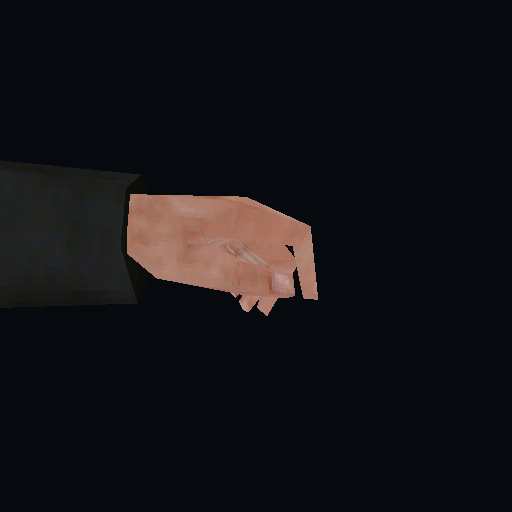
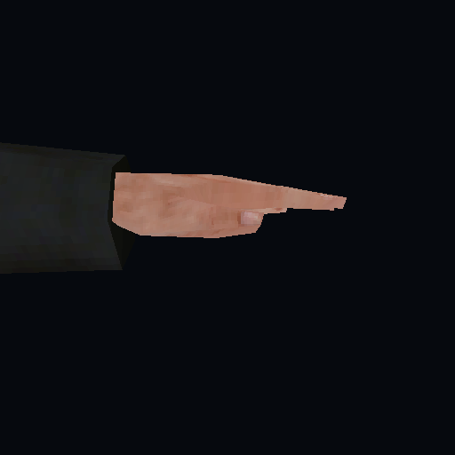

# Parity continuation and integration evidence — 2026-10-27

This milestone improves the owned engine paths and the Engine Lab workbench.
**The campaign is not playable and none of the six first-mission gates is
closed.** The seven work stages below are a dependency plan, not seven completed
features or a percentage of the original game.

The reference checkout is [mafia-re
`eb5a9216eea23210e96a3148e351e8211b27e240`](https://github.com/Marvisak/mafia-re/tree/eb5a9216eea23210e96a3148e351e8211b27e240).
Final build, tests, original-data probes and Lab captures used frozen local
source revision `72612874ddb3eb47b63a486c070907efe0e3cf82`. Later documentation
and screenshot additions do not change its Rust, shader, dependency or script
bytes. The Lab executable SHA-256 is
`df5e672b147ac6430ee4f3ef45102152aa85ce18a5c594999e3301b37ea07959`.
Original files and private analysis remain outside Git. The original PC and
PS2 executables were not run for this milestone.

## Delivered changes and the remaining seven-stage plan

| Stage | Implemented and reviewed scope | Next acceptance boundary |
| --- | --- | --- |
| 1. Audio, rendering and factory contracts | [#27](https://github.com/dnesdan/lost-heaven-reborn/pull/27): sound-cache reopen identity, live playback flags and vehicle flags. [#28](https://github.com/dnesdan/lost-heaven-reborn/pull/28): class-specific fade, primary-sector backdrop visibility, first-group alpha and per-draw depth bias. [#29](https://github.com/dnesdan/lost-heaven-reborn/pull/29): sparse actor-factory defaults. | Native renderer/audio comparisons, device behavior and remaining named actor factories. These fixes do not complete either subsystem. |
| 2. Ordered mission loading and cleanup | [#29](https://github.com/dnesdan/lost-heaven-reborn/pull/29) binds actor/program source roots and deferred sound resolution to the enclosing live loader. [#30](https://github.com/dnesdan/lost-heaven-reborn/pull/30) retains interrupted ownership and makes host terminal disposal one-shot. | Actual `C_mission::Open`/active `Close`, including ordered check/road/cache/sound dependencies and final state publication. `MissionLoadSession` is a diagnostic composition, not that native operation. |
| 3. Actors, programs and game loop | Base/detector/railway source owners can be installed in the ordered intake. [#36](https://github.com/dnesdan/lost-heaven-reborn/pull/36) loads startup replacement rows once and leases the real table through canonical/car lifetimes. | MISE01 actor kind 27 and subsequent named classes/LoadData; compiler, VM, original GameInit and scheduler. Retained source text is not executed gameplay. |
| 4. Camera, controls, menu and HUD | [#31](https://github.com/dnesdan/lost-heaven-reborn/pull/31) restores supported menu navigation families and Shift+Tab; existing camera/control/table dependencies remain available. | Original profile/component callbacks, active player/taxi camera and collision, HUD and authored menu-to-mission flow. Lab camera controls are host tools. |
| 5. Materials, animation and presentation | [#32](https://github.com/dnesdan/lost-heaven-reborn/pull/32) advances actual owned material frames on the driver timeline and closes failed setup owners. [#35](https://github.com/dnesdan/lost-heaven-reborn/pull/35) owns MRPH weights and per-visual render positions. The Lab integration adds a bounded animated-material standalone parser path. | General model animation/controller time, blending, events, rotation/scale, animated lit visuals, environment-texture rendering and visible original-content material regression. |
| 6. Navigation, AI and mission flow | [#37](https://github.com/dnesdan/lost-heaven-reborn/pull/37) owns populated navigation node/connection arrays and their ordered load/resize/destruction dependencies. | Production `check.bin` binding and signatures, pathfinding, road integration, AI, pursuit, cutscenes, checkpoints, objectives, restart and first-mission completion. |
| 7. Broader content and platforms | [#33](https://github.com/dnesdan/lost-heaven-reborn/pull/33) admits original hyphenated mission directories. Five final-source mission probes, all 3,143 model files, PC binary evidence and new original PS2 symbol intake were examined. | More supported source domains and repeatable authored missions; original-runtime comparisons, native Windows/Vulkan, macOS/Metal and physical audio output. |

The pinned reference still contains GameInit/Done and road-reader stubs. Those
dependencies require binary-backed reconstruction; copying their declarations
cannot supply a functioning mission. Keep [LS3D/library scope, Game.exe
compatibility and the six first-mission gates](../GOALS.md) separate.

## Engine Lab integration

The integration preserves the history and workbench features of
[#26](https://github.com/dnesdan/lost-heaven-reborn/pull/26): public scenes,
installation browser, presentation previews, camera/model tools, driving input
and portable presets. It composes them with the current owners rather than
replacing newer code with the earlier branch.

- A seventh **Materials** tab reads live material slots, current frame aliases,
  raw color/environment clocks, delays, remainders and loop indices. Inspection
  does not call lazy getters, consume random values, tick or add references.
  Counts cover all materials; the displayed animated rows are capped at 128.
- **Diagnostics** shows actual mission frames, completed objects, frame-name
  publications, actors, source programs, content allocations, startup rows,
  reached cursor/error and retained cleanup owners. These are live intake and
  ownership observations, not mission-progression counters.
- Candidate scenes/renderers are prepared before retiring the active source.
  Controller/material cleanup order, fatal close errors and retained startup
  leases survive the integration. Reload rebases the host sampler while
  preserving the driver timeline used by newly admitted materials.
- Every canonical/car snapshot receives its next checked per-scene traversal
  number. The scene picker uses the same bounded mission-name validator as the
  CLI, including hyphens.
- The real standalone CLI chain now has an explicit animated-material parser
  route. It requires an animated material, restricts frame/visual classes and
  leaves subsequent unsupported-effect guards intact. A serialized public
  4DS/bitmap fixture exercises CLI loading and live frame changes under both
  default and Lab feature profiles.

Actual native X11/software-Vulkan Lab capture, 960 × 700, after reload and a
second controlled step. Driver time is 32 ms; the new scene's update count is
one. The panel shows 3,183 objects, 27 actors, 23 startup rows and the exact
kind-27 boundary. No interrupted Scene/Car cleanup is retained in this run.

The same original scene has 5,161 materials in one arena, including one
animated material with 20 color frames. Controlled steps from 32 to 96 ms move
its actual index 0 → 1 and current texture identity 30174 → 30175. Overlay-free
captures at the unchanged camera have **zero changed pixels**. This verifies
the original owner's clock/alias advance but does not prove visible original
material animation in this view. Synthetic GPU tests separately prove visible
material-frame changes. Environment-texture rendering remains unavailable.

The final native run exercised F1, F2 resume/pause, F3 steps, F4 reload,
Diagnostics/Materials and Escape exit 0. Reload retained 16 ms; the next step
reached 32 ms. The test display was stopped after the window exited. This run
does not repeat the earlier workbench's complete preset/vehicle interaction
matrix; those dated results retain their original scope.

## MRPH rendered evidence

| Live weights `[1, 0, 0, 0]` | Live weights `[0, 1, 0, 0]` |
| --- | --- |
|  |  |

These are unmodified 512 × 512 Rust software-Vulkan captures from the same
complete original model and camera. All 30 frames and 11 draws remain present;
only the live MRPH weights change. The focused view shows the hand, not a
facial animation. The actual upload changes 166 vertices; the shown pair
changes 16,997 pixels. Final graphics bytes after close/reclamation are zero.
[The full-model view](../screenshots/2026-10-27-morph-full-model.png) supplies
context. A private harness selects the camera; no original asset was changed.

The harness uses the same frozen source; executable SHA-256
`8af77102308d2c428a62f996d0cbb688491f0720e023ceff9e494fec9990b357`.
The model input SHA-256 is
`4881dbc4115f4d1caa80b95453d26e867047f00561eb3fab160f1e141be82f02`.
The captures establish an actual owned deformation/render consumer, not
original-renderer pixel equivalence or authored character animation.

## Final original-PC input probes

Each row used the final Lab executable with `--mission-load-probe` and explicit
`--probe-model-dir Models`. All commands returned exit 1 at their reported
unsupported boundary; none is a successful MissionOpen or gameplay result.

| Mission | World frames / completed Scene2 objects | First reached boundary | Terminal disposal |
| --- | ---: | --- | --- |
| `mise01` | 1,415 / 3,183 | Kind 27 unavailable; cursor 3,795,696; entry `0x00544a16`; 27 actors retained before disposal. | Complete; every reported owner/resource category reaches zero. |
| `intro` | 106 / 28 | Camera `NumericDomain("Normalize")`; cursor 39,797; entry `0x00544604`. MRPH support advances the earlier ten-object boundary. | Complete; every reported owner/resource category reaches zero. |
| `00menu` | 100 / 69 | Unsupported animated model (`menugl`); cursor 466,049; entry `0x0054220a`. | Interrupted model cache retained: 24 frames, 11 cache allocations, three visual graphics owners, 22 textures and 52 visual allocations; registry capacity 32 remains. This is not a zero-cleanup result. |
| `mise02-saliery` | 0 / not reached | World parser rejects visual type 4. The hyphenated directory is admitted and actual asset I/O occurs. | Complete; every reported owner/resource category reaches zero. |
| `mise03-morello` | 1,404 / 1,558 | Unsupported actor-map name domain; cursor 1,535,043; entry `0x005455e0`. | Complete; every reported owner/resource category reaches zero. |

The full model-namespace scan enumerated 3,219 paths, skipped 76 non-4DS paths
before payload loading and actually read/parsed **3,143 model files**. The
standalone parser chain admits 1,776 instead of 1,768 after the bounded animated
route. Of its eight newly admitted files, seven carry material-effect flags
outside the strict assembly gate and the other has an empty base-texture name. Parser
admission is not a claim that 1,776 models render or that those eight models
complete a live standalone load.

All 14 supplied DTA archives and the two PC executable/library inputs retain
their recorded SHA-256 values. The original data is used locally only.

## Review and verification

Every substantial code PR in this stack received **three sequential independent
reviews**, with fixes and finding-reviewer rechecks before the next round.
Authors did not review their own implementation. These are source reviews,
separate from the runtime checks below. Material findings fixed along the way
include padded actor-field cursor advancement (#29), last-reference listener
lifetime (#30), material setup-error cleanup (#32), shared MRPH draw positions
(#35) and startup-table leases across interrupted/early-return cleanup (#36).

The Lab's three final reviewers covered the complete integration range
`8183d9671f1a5488093ac5a153ac1cabe8b8ce6f..72612874ddb3eb47b63a486c070907efe0e3cf82`.
Reviews 1 and 2 rechecked the final parser/CLI-test addition; review 3 examined
the final full diff. No confirmed P1/P2 remained. The preceding workbench's
framing and traversal-number fixes remain preserved.

| Verification layer | Final result and scope |
| --- | --- |
| Required `scripts/test.sh` | Formatting/build passed; 1,391 engine tests passed, nine ignored, **two failed** at existing host x87 before-state prerequisites. The required gate is not green. |
| Supplemental workspace, all features | **1,649 CPU tests passed**, 21 GPU tests left ignored in that run; only the two named x87 cases below were filtered. |
| Default main binary | **66 passed**, one GPU test ignored. This is an overlapping profile check, not an extra unique-test total. |
| Explicit ignored GPU suite | **21 passed** on Linux software Vulkan, including engine, application and renderer readbacks. |
| Static/build | Workspace/all-target/all-feature Clippy with `-D warnings` and the final `engine-lab` build passed. |
| Python/public metadata | Progress tests **47 passed**, generated snapshot check passed. Analysis-wrapper tests **9 passed** on their unchanged source. Accepted-function/gate counters are unchanged. |
| Original input / interactive | Five probes above; actual MRPH captures; final Lab steps/reload/material inspection and exit. Original-runtime, hardware audio and other native platforms were not exercised. |

The two unchanged failing tests are
`native_transform::vector_x87::tests::preserves_long_mode_x87_pointers_across_actual_helpers`
and
`native_transform::vector_x87::tests::preserves_full_fxsave64_state_with_pending_exception_and_live_sse`.
Both fail their `FIP > u32::MAX` before-state precondition on this host. Their
assertions remain intact. Supplemental passing runs do not verify the later
high-pointer/state-preservation assertions or replace the required gate.

## PS2 evidence and tool boundary

The supplied disc archive passed integrity checking. The locally extracted
PS2 executable `SLUS_206.71` is 5,613,500 bytes, SHA-256
`adf4944c5cdac23fcc4e9af9ef3ec1ba6234497e57cec2af2ff1a7a15c62a46f`.
Its actual ELF symbol table contains 15,236 entries, including 7,788 function
symbols, and 116,033 main-section relocations. These are metadata counts, not
ported or runtime-verified functions. No DWARF information was found.

| Original PS2 linker symbol | PS2 virtual address | Evidence use |
| --- | --- | --- |
| `LoadNodes__10C_web_pathFP7C_chunk` | `0x00391870` | Original navigation naming lead. |
| `Resize__10C_web_pathFUi` | `0x00390e30` | Original path-owner naming lead. |
| `Resize__10C_web_nodeFUsP10C_web_path` | `0x00390640` | Original node-owner naming lead. |
| `SetWeight__9I3D_morphFiif` | `0x0043ef50` | Original MRPH method naming lead. |
| `LoadSourceCode__9C_programFP7C_chunk` | `0x001b6740` | Original program source-loader naming lead. |

REA 6.7.0 (`6d356b84344659085f2b912857b5e27fe0160c9b`) with Ghidra 12.1.4
rejects this R5900 target before analysis: `capability_unavailable`,
`unsupported_provider`, `target_unsupported` / `architecture_unsupported`.
No Ghidra analysis started and no target header or capability check was bypassed.
The symbols therefore establish names and lookup leads only; they do not prove
PC layout, scalar widths, equivalent platform semantics or new whole-function
coverage. Actual PC REA evidence remains separate, keyed to the supplied
Game.exe/LS3DF hashes and each reached RVA.

## Next dependency order

Continue native MissionOpen/Close and their earlier check/road/cache dependencies;
then reached actor constructors/LoadData, program compilation/VM/GameInit and
scheduling over the actual owners. Bind player/camera/HUD and play-critical
presentation before AI/objectives/cutscenes/checkpoints. Completion requires
repeatable original menu-to-first-mission-completion and restart sequences,
followed by broader-content/platform checks. No stub default or synthetic
success should move a gate forward.

[Goals](../GOALS.md) · [run commands](../RUNNING.md) ·
[screenshot provenance](../screenshots/README.md) ·
[preceding dated evidence](mafia-re-remediation.md) · [coverage](../../COVERAGE.md)
