# Screenshot history

Actual captures from the Rust application using separately supplied PC game data. Images are compressed WebP previews; uncompressed validation captures remain private. Add dated images for visible milestones, up to 960 pixels wide and 200 KiB per image, rather than a capture for every commit. Game content retains its original ownership.

## 2026-10-25 — driving and repeated resource reload

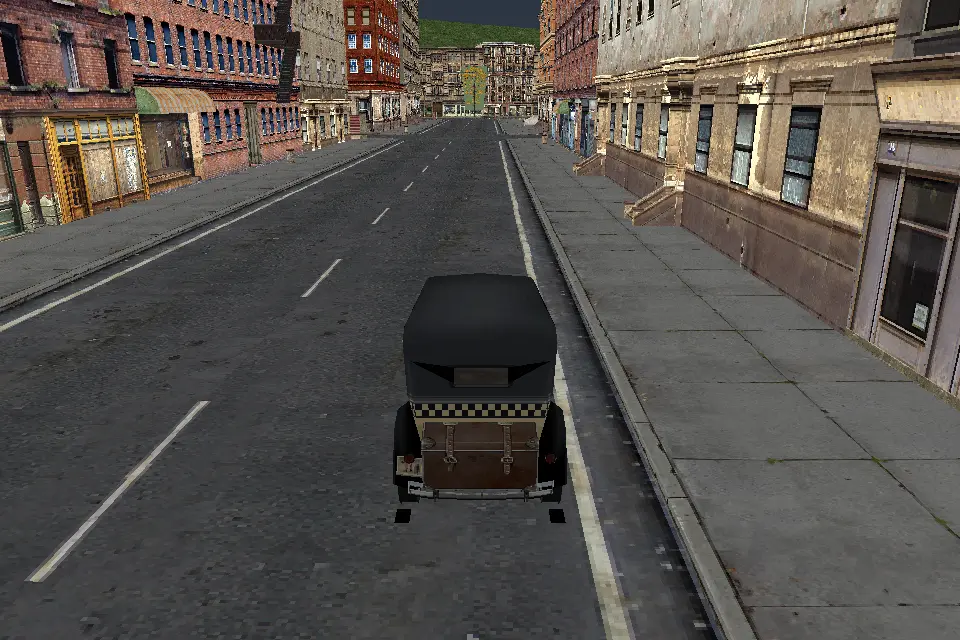

Actual debug Rust X11/software-Vulkan capture with the original taxi and MISE01
world. The run exercises three W driving sequences, three R reloads and final
Escape; each of four cleanups reports zero owned actor registrations, heap
blocks, visual buffers and textures. Five caller-owned Scene-prefix frames
remain explicit context. The 960 × 640 preview is 99,706 bytes.

This is a resource/driving regression after the Scene dependency changes.
Weather reset and sound defaults are compared separately against original code;
they are not yet bound to live Scene construction or rendering. The image uses
the existing host chase camera and unlit first-LOD renderer.

## 2026-10-24 — continuous driving preview

[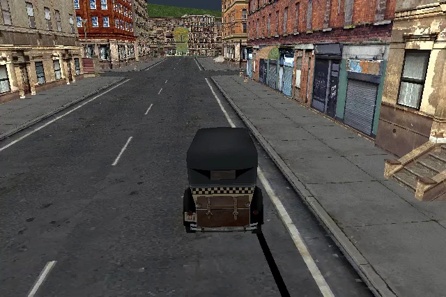](../videos/2026-10-24-car-driving.mp4)

[Watch the actual 18-second driving capture](../videos/2026-10-24-car-driving.mp4)
· 640 × 426 · 330 distinct decoded frames.

Continuous Rust X11/software-Vulkan capture from SOURCE-v4 using the original
taxi, road geometry and textures. W, both A/D steering directions, S and Space
drive the actual recovered vehicle workers; the taxi stops 55.038 metres from
its starting point. Separate debug/release window tests also verify focus loss,
R reload and explicit resource cleanup. The image is a compressed frame from
the same recording; source, binary, input and process receipts remain private.

The clip contains 17.44 seconds of actual original-WAV stereo PCM at 48 kHz.
Software capture and the capped simulation clock diverge by up to 0.706 seconds;
audio was neither stretched nor padded. This preview does not claim perfect
audio/video synchronization or physical audio-device validation. Rendering uses
the unlit first-LOD inspection bridge. Mission completion and full original
renderer/audio parity remain unverified.

## 2026-10-24 — interrupted collision and physical-piece construction

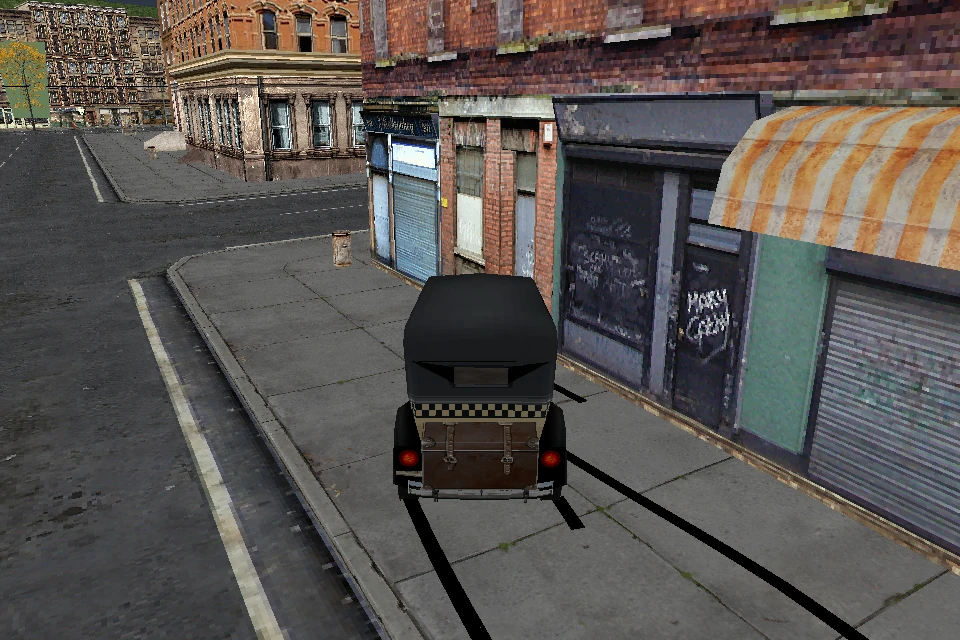

Interrupted collision prefix, not completed driving gate. This actual 960 × 640
Rust software-Vulkan capture follows 573 completed 16 ms simulation steps;
step 574 stopped at an unfinished dynamic-object collision response. The live
primary-sector graph contains the newly constructed original breakable-object
piece, and the original world uses its updated visibility state. The camera
reads the reached car pose; no further physics or body movement was applied
after the error. Rendering uses the unlit first-LOD inspection bridge.
Explicit shutdown released all counted car, heap, graphics and audio resources.
The WebP preview is 188,164 bytes; the original PNG, exact input replay,
source/binary hashes and process receipts remain private. This is a development
still, without a completed long driving run, mission gate or final video.

## 2026-10-24 — driving through the original world

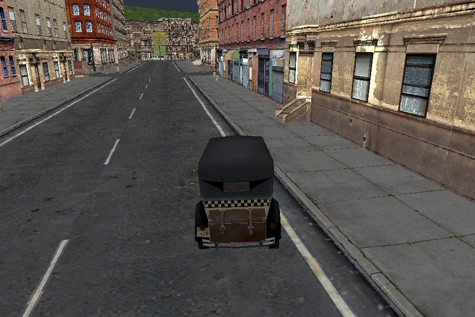

Actual 960 × 640 Rust X11/software-Vulkan capture during the SOURCE-v2 keyboard
test. The taxi moved through original road collisions using recovered Tick and
Update workers; W/S, both steering directions, Space, focus loss and R were
exercised. That run travelled 36.4 metres and released its car, heap, graphics
and audio resources. Original sounds supplied nonzero stereo PCM; this machine
has no physical audio output device. The image shows the real live frame graph,
with unlit first-LOD rendering. It does not establish mission gameplay or full
renderer parity. A subsequent longer recording exposed a separate breakable
object dependency; this still image is evidence for the passing controls run.

## 2026-10-21 — menu and static MISE01 inspection

Linux software Vulkan captures. Keyboard/mouse transitions, camera orbit and repeat-load pixel equality were checked. The retained model graph and recovered static tick path are connected to the application. These images do not demonstrate animation, driving, mission execution or original lighting/material parity.

| Czech PC menu · 640 × 480 · 55 KiB | MISE01 neighborhood and taxi · 960 × 640 · 122 KiB |
| --- | --- |
|  |  |

New Game and Exit work in the menu. The mission view is a bounded static inspection scene; the taxi cannot be driven.

## 2026-10-21 — original position animation

Actual public CLI capture of unchanged `sipka1.4ds` + `sipka1.5ds` after 25 controlled 16 ms steps (400 ms). The recovered update path changes the retained model pose and uploads its original geometry to the GPU. Separate 0/400/800 ms validation confirms movement and exact return; this still image shows the middle state. Only the documented single-root position domain is supported; this is not character or mission animation.


960 × 640 · 17 KiB · engine commit [`ed770ed`](https://github.com/dnesdan/lost-heaven-reborn/commit/ed770ed). Reproduce with the README animation command and `--headless --animation-steps 25 --capture /tmp/animation.png`.

## 2026-10-22 — original model hierarchy

Actual Linux software Vulkan capture of `4build81.4ds`: three meshes and one dummy, materialized into an owned model/frame graph. Recovered common LS3DF fields, parent transforms and guarded original point arithmetic feed the renderer. Camera, materials and rasterization remain inspection choices; this image does not establish original rendering parity or mission gameplay.

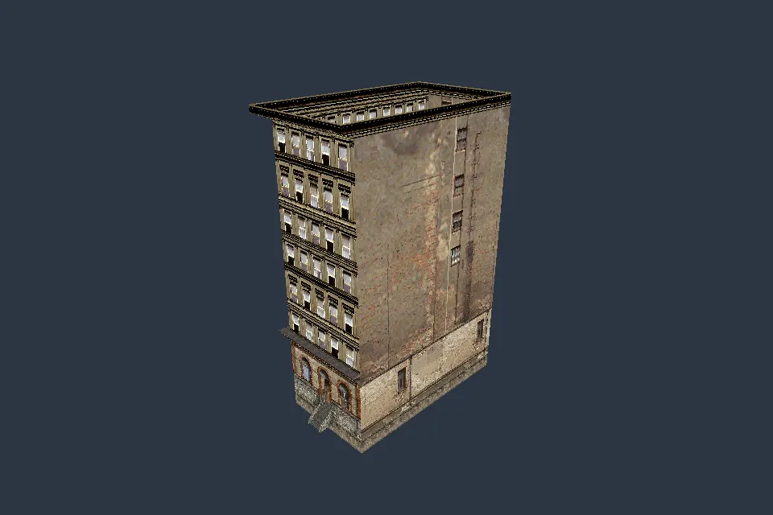

960 × 640 · 34 KiB · engine commit [`a739570`](https://github.com/dnesdan/lost-heaven-reborn/commit/a739570). Reproduce with `--model models/4build81.4ds --headless --capture /tmp/hierarchy.png`. A bounded X11 run also passed. Separate animation captures at 0/25/50 steps confirmed movement and exact return to the initial image.

## 2026-10-22 — original skinned character

Actual Linux software Vulkan capture of original `civil02.4ds`: 18 Joints and a 417-vertex first LOD. The owned hierarchy, dense joint binding, eager bounds evaluation and recovered CPU deformation supply the pose; original topology, UVs and textures are retained. A separate original-DLL comparison matches 3,124 vertex, matrix, flag and bounds words. The still image demonstrates static pose rendering, with an unlit inspection renderer; it does not show skeletal animation, original lighting or gameplay.


960 × 640 · 6.3 KiB · engine commit [`31d2bf6`](https://github.com/dnesdan/lost-heaven-reborn/commit/31d2bf600104f5ae0b656d892072f524bbc5b7a6). Reproduce with `--model models/civil02.4ds --headless --capture /tmp/skin.png`. Repeated captures are pixel-identical; a bounded X11 run also verified camera input.

## 2026-10-22 — original Tommy skeletal pose

Actual Rust X11/software-Vulkan capture of `TommyTAXIDRIVER.4ds` with `anims/breath01a.5ds` independently sampled at 1,000 ms. The owned hierarchy runs original Target direction updates, morph weights and CPU skinning; original geometry, UVs and textures are retained. The camera was orbited with actual keyboard input. This still image does not establish controller playback, original lighting or gameplay.


640 × 427 · 2.9 KiB · engine commit [`d735e53`](https://github.com/dnesdan/lost-heaven-reborn/commit/d735e53971d7cd7d3c75fe985d021253a8ec7cb3). Reproduce the pose with `--model models/TommyTAXIDRIVER.4ds --animation anims/breath01a.5ds --sample-animation-ms 1000`; use arrow keys to orbit toward the face. Add `--headless --capture /tmp/tommy.png` for the default inspection view. Static plus five separately sampled poses match 81,216 original-code words; the screenshot is a separate rendering check.

## 2026-10-24 — Rust car construction and initialized inspection

Actual Linux software Vulkan captures of original `taxi00.4ds` and `polcad00.4ds`, source commit `5b28728751235bfac76014e97f54db6370bf14d1`. Rust constructs each Car from allocator bytes, runs bounded primary Init and renders indexed first-LOD meshes, materials and textures exported from that same initialized ModelArena. No original executable, DLL or native constructor-state fixture is needed by this mode.

| Initialized taxi · 960 × 640 · 11.1 KiB | Initialized police car · 960 × 640 · 7.8 KiB |
| --- | --- |
| 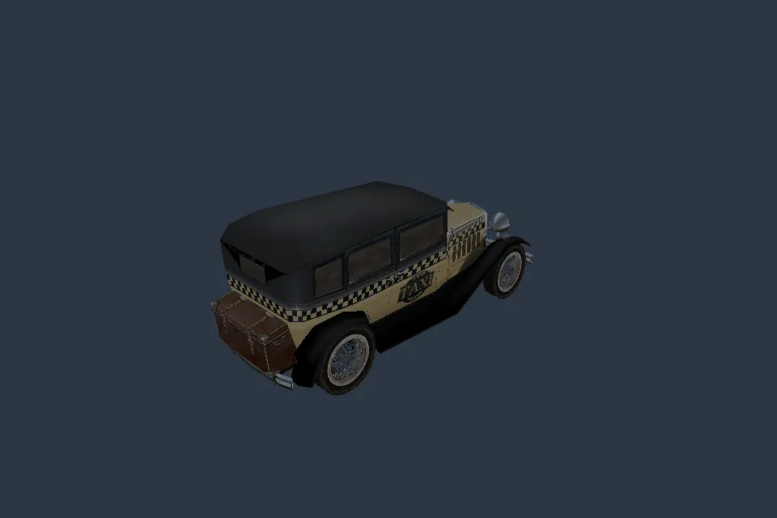 | 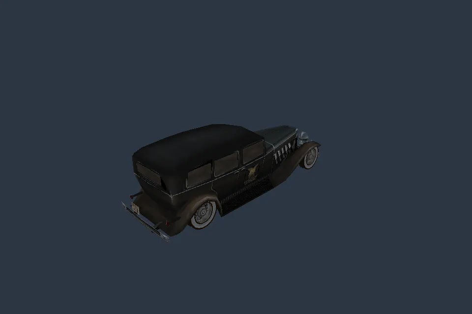 |

Reproduce from a user's original installation:

```sh
./scripts/run.sh --root /path/to/Mafia --model models/taxi00.4ds --car-inspection --headless --capture car-taxi.png
./scripts/run.sh --root /path/to/Mafia --model models/polcad00.4ds --car-inspection --headless --capture car-police.png
```

Omit `--headless --capture ...` for the windowed mode; arrow keys orbit the camera and R explicitly destroys/reconstructs/reloads the Car. Repeated and cross-profile captures agree. A bounded X11 run changed the camera pixels, then R restored the default view and produced explicit cleanup. The earlier default MISE01 view remains pixel-identical as a separate old-mode control.

Rendering is unlit first LOD with nearest texture sampling. Proven indexed color keys and grayscale masks use an opt-in host cutoff of 0.5; unsupported non-grayscale masks stay opaque and are reported per draw. Native GPU format choice/threshold, environment reflections, blending and original lighting/full renderer parity remain unverified. This is car inspection, without driving, mission play or Metal validation. Cleanup covers Car/model/Game-owned resources; five host Scene-prefix frames remain explicit context, without complete native Scene construction/Close.

## 2026-10-24 — recovered car wheel steering

Actual Linux software Vulkan captures from the release build at `bf8b170f7dada50854293f761afdff5f45d52bb3`. Original first-LOD meshes, textures and live wheel frames come from the same initialized ModelArena. Recovered SetSteer and UpdateSteeringWheels update the steerable-wheel quaternions; the graph update publishes them before rendering. The WebP exports are lossless and pixel-identical to the captured PNGs. Current-source validation reproduces those pixels and binds the verified executables to this source.

| Taxi left · 960 × 640 · 47.5 KiB | Taxi right · 960 × 640 · 50.2 KiB | Police · 960 × 640 · 48.8 KiB |
| --- | --- | --- |
| 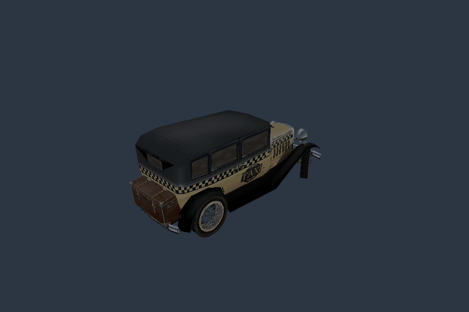 | 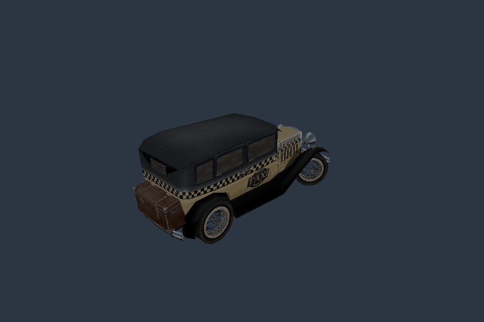 |  |

Reproduce from a user's original installation:

```sh
cargo run --locked --release -p lhr-engine -- --root /path/to/Mafia --model models/taxi00.4ds --car-inspection --steer -1 --steer-steps 120 --headless --capture /tmp/taxi-left.png
cargo run --locked --release -p lhr-engine -- --root /path/to/Mafia --model models/taxi00.4ds --car-inspection --steer 1 --steer-steps 120 --headless --capture /tmp/taxi-right.png
cargo run --locked --release -p lhr-engine -- --root /path/to/Mafia --model models/polcad00.4ds --car-inspection --steer 1 --steer-steps 120 --headless --capture /tmp/police-steering.png
```

These captures use 120 controlled 16 ms host inspection-clock steps. `--steer-steps` defaults to 1 and accepts 0 through 600. Zero steering or zero steps reproduces the default image; repeated captures and debug/release RGB pixels agree. Omit the headless/capture arguments for interactive mode: hold A or D to steer, use arrows and W/S for the camera, and press R for explicit cleanup and reload. Key release, focus loss and reload reset live input.

Rendering remains unlit first LOD with nearest sampling and the documented host 0.5 cutoff for admitted masks. Original lighting, reflections, blending, native GPU behavior and Metal execution remain unverified. The car body stays stationary; these images establish wheel steering without road-contact, driving or mission gameplay. Runtime uses original assets without an original executable.

## 2026-10-24 — Original world and car GameInit

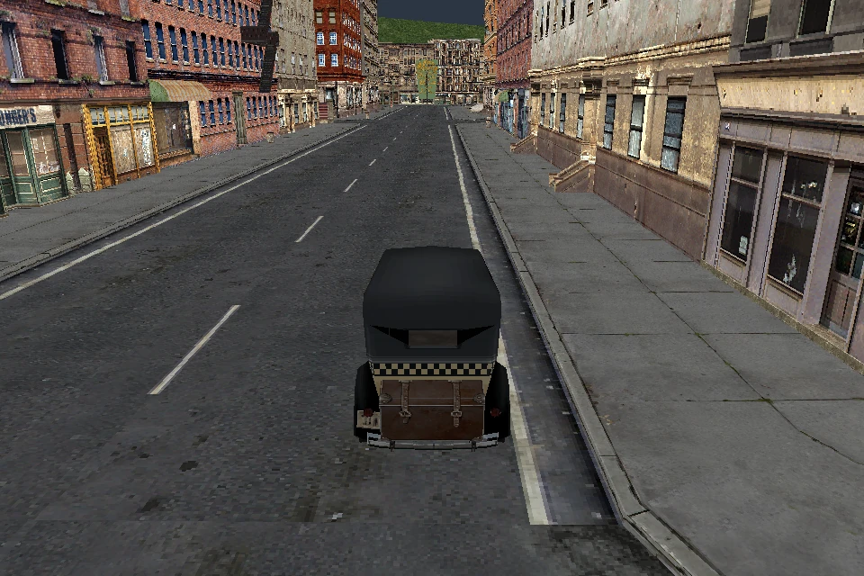

Actual Rust software Vulkan capture after original-data car construction, Init
and GameInit. The view combines the same live car/primary-sector frame graph
with original world geometry, textures and nearby cache-model placements.
This development capture contains no simulation ticks and is not driving
verification. Rendering uses the unlit inspection bridge; unsupported billboard
resources and original lighting/shadow presentation remain outside this image.
The 960 × 640 WebP preview is 194,066 bytes; the original PNG and source/process
receipts are retained privately.


## 2026-10-25 — constructor-owned Scene CPU lifetime


Actual current debug Rust window capture from code `c84bcff`, using original
assets and Linux software Vulkan. The 960 × 640 WebP is 118,386 bytes. The
source-bound window regression exercises W/A/D/S/Space, three R reloads and
Escape, with four zero-owned CPU cleanups including the Scene. App and Xvfb
exit successfully and are reaped. The still is from the first W run before R.

Reproduce with `./scripts/run.sh --root /path/to/Mafia --model models/taxi00.4ds --car-driving`.
Rendering is unlit first LOD with a host chase camera. The supplied data has no
Snow texture; this image does not show weather drawing, full native Scene/device
behavior, original renderer parity or mission gameplay. CPU audio mixing does
not establish hardware audibility. No new video was created.

[Current scope](../../COVERAGE.md) · [source-bound records](../progress.json) ·
[earlier documentation](../history/README.md).


## 2026-10-25 — driver Scene registry and CPU cleanup

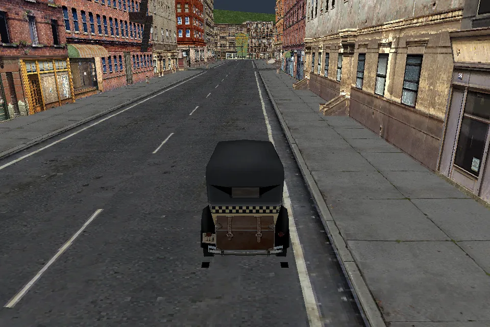

Actual current debug Rust window capture with original assets and Linux software
Vulkan, 960 × 640, 118,362 bytes. The still is from the first W run before R. The
window regression exercises three reloads and four zero-owned CPU cleanups,
including Scene frames and driver registry/capacity. App and Xvfb exit 0 and are
reaped. Reproduce with `./scripts/run.sh --root /path/to/Mafia --model models/taxi00.4ds --car-driving`.

This is an unlit first-LOD driving/reload regression with a host chase camera.
It shows no weather drawing, railway gameplay, mission execution or native
device/renderer parity. Native device discard remains unexecuted in the CPU
projection. Supplied original data has no Snow texture. No new video was made.

Source: `b62dd2ce1565ed5139399c13e371e9e1febe18f7`. [Evidence and limits](../../COVERAGE.md).
