# Screenshot history

Actual captures from the Rust application using supplied PC data or named public procedural scenes. Images are WebP previews or original PNGs. Scene previews normally stay within 960 pixels and 200 KiB; native UI captures may retain their full window dimensions for readability. Sanitized receipts can be published; original inputs and raw logs remain private. Add dated images for visible milestones. Game content retains its original ownership.

## 2026-10-28 — reviewed integration and fresh original-data checks

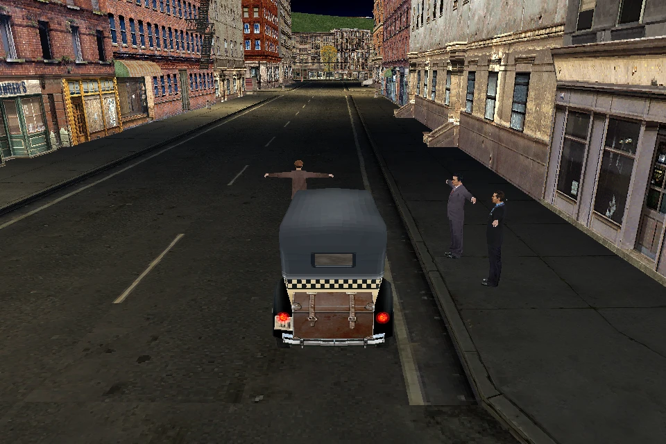

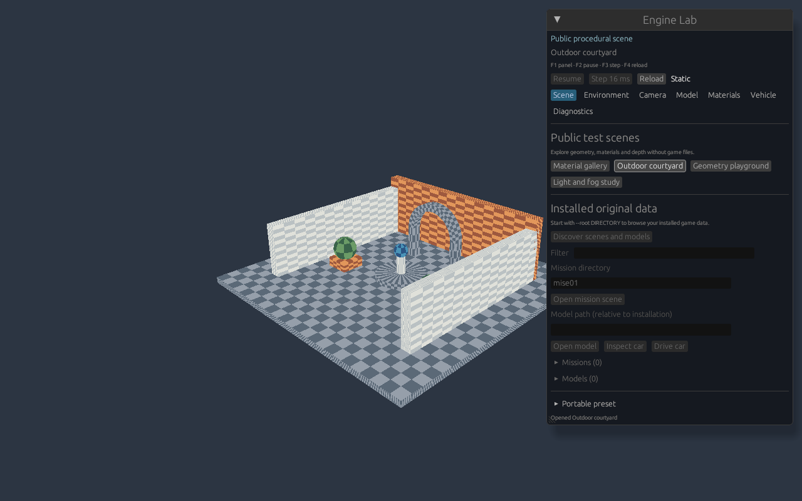

[Menu inspection](2026-10-28/menu.webp) ·
[MISE01 inspection](2026-10-28/mise01.webp) ·
[public Lab scenes and receipt](2026-10-28/lab/receipt.json) ·
[image hashes and check summary](2026-10-28/evidence.json).

All captures use source `c60abc133fc789502ac0a1acd301088ee56bea0c`, whose tree
equals merged integration `fec33b59688760f9fd33c02060a5d13c9a750b50`.
They were inspected on Linux x86_64 with Mesa llvmpipe Vulkan. Native UI used
Xvfb. Public scene PNGs are 960 × 640; the unmodified UI PNG is 1280 × 800.
The three original-data previews retain 960 × 640 and use WebP quality 90,
without crop or resize; exact source PNG hashes are recorded in evidence.json.

The Lab changed from gallery to courtyard. Taxi telemetry records throttle,
steering and handbrake input, followed by zero tracked resources at cleanup.
The MISE01 image is static inspection at the known unsupported-kind-27 frontier;
it is not authored gameplay. The menu PNG was produced before its existing
animated-model limitation caused retained interrupted cleanup and exit 1.
The [full record](../implementation/2026-10-28-pr-integration.md) includes these
limits, executed tests and separate PS2 metadata evidence.

## 2026-10-27 — live mission/material inspectors and MRPH deformation


Root-inspected final Rust X11/software-Vulkan captures, both 960 × 700, from
source `72612874ddb3eb47b63a486c070907efe0e3cf82`; executable SHA-256
`df5e672b147ac6430ee4f3ef45102152aa85ce18a5c594999e3301b37ea07959`.
The first shows 3,183 completed MISE01 objects, 27 actors and the explicit
kind-27 frontier at byte 3,795,696. F4 reload preserves driver time 16 ms and
the next F3 step reaches 32 ms. The second shows the original 20-frame material
at index 1 after 96 ms. Its alias advances, but overlay-free captures at 32/96 ms
have zero changed scene pixels at this camera; visible original material
animation is not established. F1, pause/resume and Escape exit 0 were exercised.
Task-owned UI/display processes were stopped.

The two WebP previews use quality 90 encoding with no crop, resize or other
image edits; exact PNGs remain private. They are 73,492 and 72,002 bytes.
SHA-256 values respectively:
`c75a35011e517ac7a7c056c451b1f472ca4eec0adb63dd50249397ce80987586`,
`41a169ac8c6d89745e6e3346a435197a9193610be8a19dc7e907970679b2d331`.

| Actual MRPH weights `[1, 0, 0, 0]` | Actual MRPH weights `[0, 1, 0, 0]` |
| --- | --- |
|  |  |

The same complete 30-frame model, 11 draws and host camera are retained.
Changing live MRPH weights changes 166 uploaded vertices and 16,997 pixels
in this focused hand view. [Full-model context](2026-10-27-morph-full-model.png).
All three are unmodified 512 × 512 PNGs from the actual renderer, not asset
exports. Final graphics bytes are zero. Harness executable SHA-256:
`8af77102308d2c428a62f996d0cbb688491f0720e023ceff9e494fec9990b357`.

| PNG | Bytes | SHA-256 |
| --- | ---: | --- |
| Full model | 47,317 | `e78bb4aa849254acacc4a936a8afd8565b6709070a4c95fd5a4f13daa9098289` |
| Hand before | 37,592 | `557034ebc9f7595ff03e1962746fac9886f92b4ce99a911efb6825eea10aa21f` |
| Hand after | 32,794 | `154e335e5ad3ed207cca32cfc9ba92324a90eb4adc1fba92caf2142e51b735b4` |

These images prove bounded Rust rendering/inspection, not authored mission
execution or original-renderer equivalence. No original executable ran.
[Implementation, reviews, probes and remaining gates](../implementation/parity-continuation.md).

## 2026-10-26 — road, source sky and complete object intake


Root-inspected Rust software-Vulkan capture, 960 × 640, 64,626 bytes.
The MISE01 inspection loaded 3,183 scene objects, stopped at actor dispatch
and produced 267 draws, including five actual `zapad` sky groups. A separate
GPU-only sky-texture change affected 136,934 pixels; restoring the textures
restored identical full-frame RGBA bytes. Close released the counted owners.
This is scene inspection; authored actors, scripts and mission play remain open.

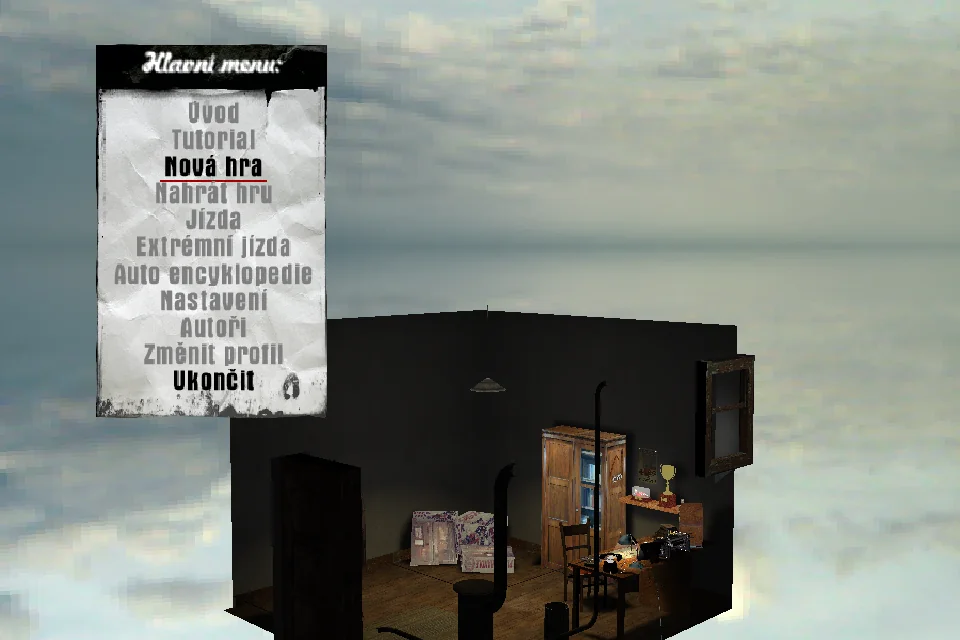

The menu capture is 960 × 640, 44,472 bytes. Its loader stops at unsupported
`menugl` model animation and retains an interrupted cache. It does not share
the successful MISE01 disposal result. Both captures used reviewed source
manifest `0c60e6fc…`; the final `43af8105…` revision adds shared driving
audio binding and explicit Scene/Vehicle frame-owner tags.
Full receipts and checks are in [current evidence](../implementation/mafia-re-remediation.md)
and [progress.json](../progress.json). WebP SHA-256 values, respectively:
`8ca3b1de99d597632c2599b6e80754e8c3c73c5c7d6d6b2fd256838e3f0a4d63`,
`e9d8b663171eefdb405cb458183c59d367e377b4905861eef8aecab371c94586`.

## 2026-10-26 — Engine Lab and shared driving audio

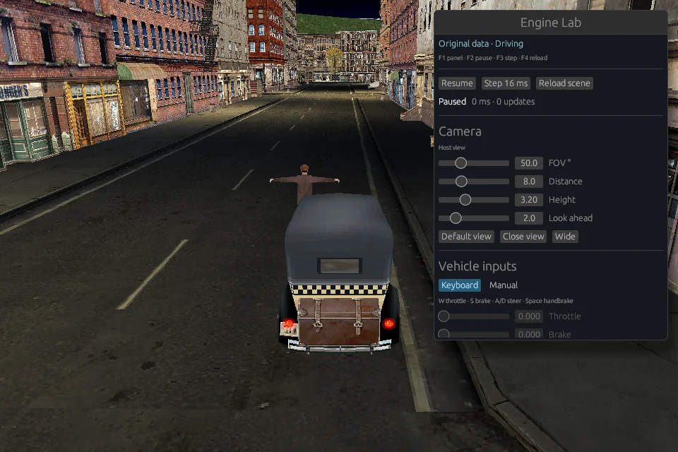

Root-inspected initial paused frame, 960 × 640, 98,258 bytes, from final source
manifest `43af8105…`. The same guarded run subsequently exercised W/A/D/S/Space
and motion, real FOV 50°→65°, pause, one 16 ms step, focus loss with cleared
held inputs, three F4 reloads and Escape exit 0. Four CarRuntime cleanup reports
have seven zero CPU counters; actual Scene/audio/cache/driver checks also passed.
Fonts remained readable after rebuilding the device and UI context. Source,
executable and eight input archives were unchanged; owned processes were reaped.

The wider host chase view was obstructed by nearby geometry. Original camera
collision, mission progression and hardware audio remain unverified. Sparse
status logs are not callback counts; clock-gap handling has separate tests.
No video was created. WebP SHA-256:
`36af15d47fc1b8c919f4edd35ee8df0238ba9527bf90c9bb1732471567c1a183`.

## 2026-10-26 — canonical scene and cache models

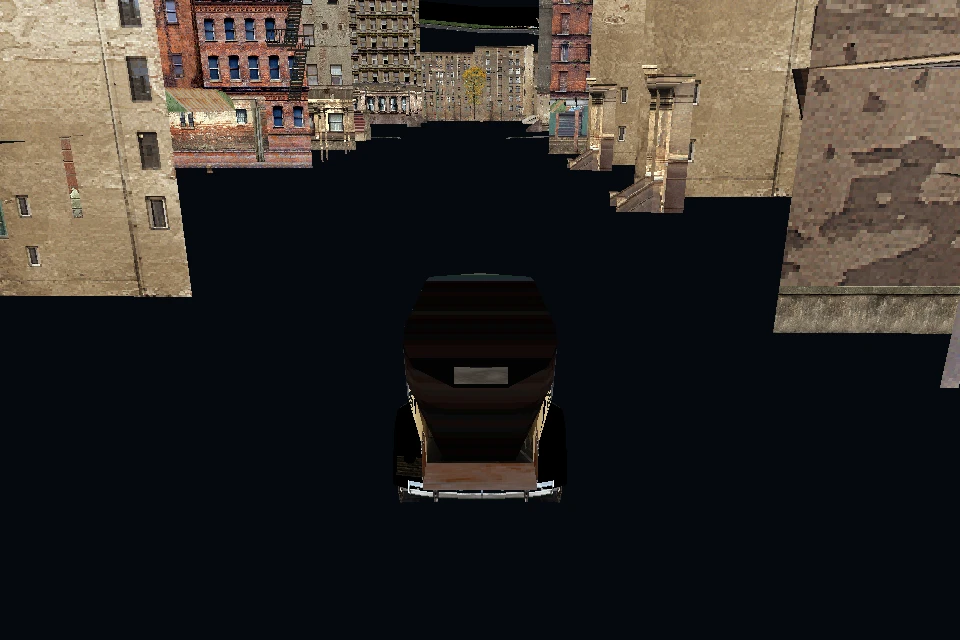

New root-inspected Rust X11/software-Vulkan capture from code
[`dddaf539`](https://github.com/dnesdan/lost-heaven-reborn/commit/dddaf539c9b874b9cf7a67d866532d901729df18),
960 × 640, 91,070 bytes. Actual nearby cache models now share the retained
Scene/Camera/resources with the taxi. Buildings are visible; the road and sky
remain dark or absent, with the cause unresolved. This image records that
limitation and does not establish original-renderer fidelity.

W/A/D/S/Space, three R reloads and Escape passed. Four cleanups each reported
seven zero CPU counters; owned UI processes were reaped. The 344-file source
fingerprint and executable SHA remained unchanged before and after the run.
PCM mixing has separate CPU evidence; audible hardware playback is unverified.
WebP SHA-256: `57ee7ea32ace898779cf74c34bbe1a9d5ed38cefa4f4149061f89a065953bc41`.

## 2026-10-26 — actual saved-lightmap consumer

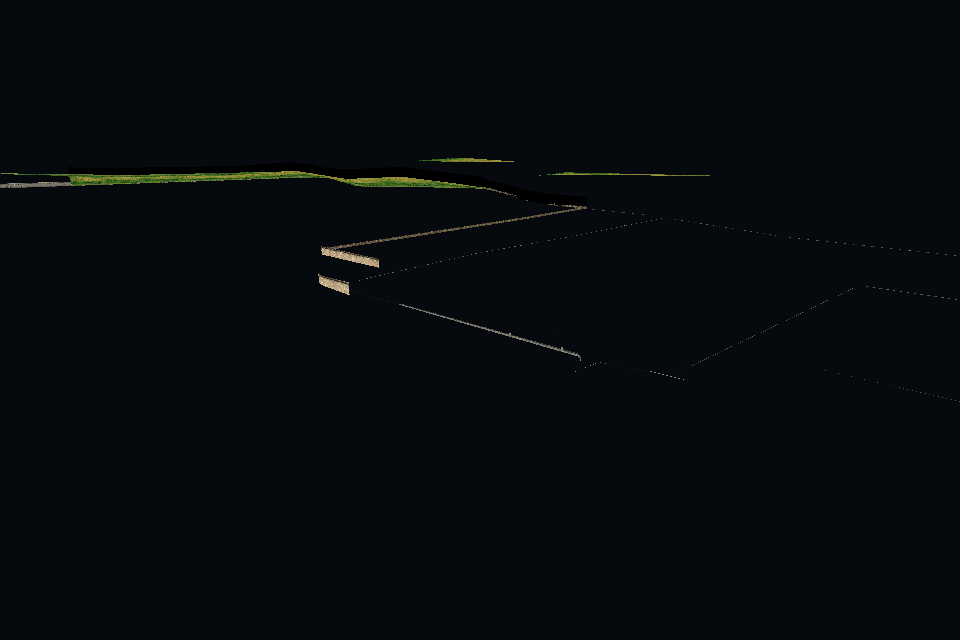

Same code, real loaded Scene/Camera, with a host-focused view of `base247`.
The capture is predominantly dark with sparse visible edges. This is a bounded
resource/GPU consumer check, not a finished scene or gameplay image. Replacing
only the actual saved atlas with white on the GPU changed 53 pixels; restoring
it restored the full RGBA frame byte for byte. The white diagnostic stays
private. Scene Close and final resource reclamation reached zero counted
resources. Default-menu and MISE01 headless captures also completed; authored
mission execution and original-runtime image parity remain open.

Root-inspected lossless WebP, 960 × 640, 11,768 bytes; decoded RGBA matches the
normal GPU PNG exactly. SHA-256:
`8769778581bafec5b2ba973b53ff1e9d6703d6a09d2860cc1ef083ff7de0f3e2`.
Existing images and videos below retain their original dated scope; no video
was created for this milestone.

## 2026-10-26 — standalone driving after the staged merge

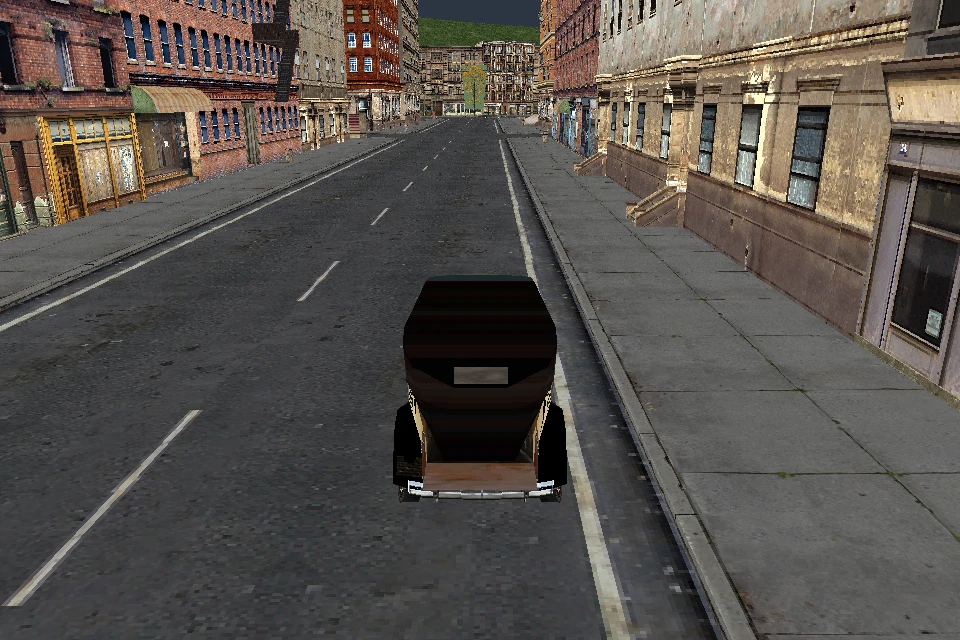

New root-inspected Rust X11/software-Vulkan capture, 960 × 640, 200,062 bytes,
bound to accepted source `a4dee6d4cce02564e72d0fc23e6d9fe6fdc39abe`.
W/A/D/S/Space, three R reloads and Escape were exercised; four cleanups have
seven zero CPU counters and task-owned processes are reaped/absent. PCM mixing
was active, but the host audio device was unavailable; audible playback is
unverified. WebP SHA-256:
`fc2badd3d3a17e44c0d90b590d1b19245b975e900b4f64f54931c1483db05294`.
The visible host chase camera and standalone driving do not establish authored
mission execution, saved lightmaps or original-renderer parity. No new video.

## 2026-10-25 — standalone driving after CPU world-loader changes

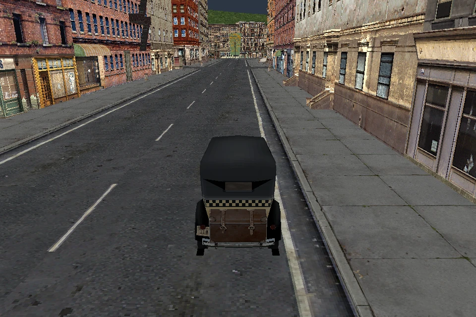

New frozen Source-v4 Rust X11/software-Vulkan capture, 960 × 640, 201,290 bytes,
visually inspected by the root. W/A/D/S/Space, three R reloads and Escape were
exercised; four cleanups have seven zero CPU counters and owned processes reaped.
The host chase camera and unlit driving remain visible. The 1415-frame CPU world
probe has separate evidence; this image is not canonical world/mission rendering,
native SceneOpen, loading-progress UI or original-renderer parity. No new video.

## 2026-10-25 — standalone driving, identical-executable carryover

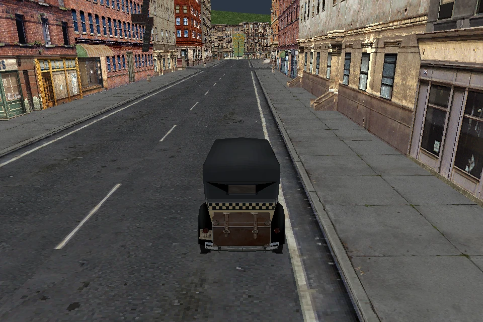

Root-inspected960×640 WebP,200,418 bytes. This actual prior Rust capture and
W/A/D/S/Space,three reloads,four cleanups/seven zero CPU counters are bound to
Source-v4 through the byte-identical executable. No new UI run is claimed.
The host chase camera and unlit driving remain visible; this is not cache
visualization, world SceneOpen, mission rendering or original-runtime parity.

## 2026-10-25 — driving after CPU occluder/light loader changes

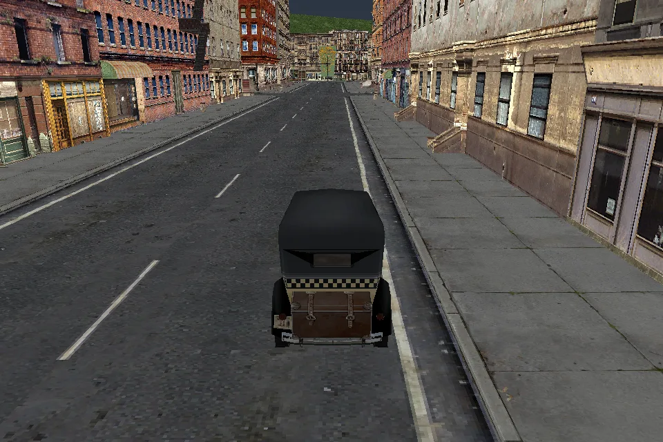

Actual frozen Source-v1 debug Rust X11/software-Vulkan capture, 960 × 640,
133,778 bytes, before the first reload. W/A/D/S/Space, three R reloads and Escape
were exercised; four cleanups have seven zero CPU ownership counters.
The host chase camera and unlit scene remain the visible standalone-driving mode.
The seven-record CPU loader prefix and retained-output checks have separate proofs;
this image does not establish mission execution or original occlusion rendering.

## 2026-10-25 — standalone driving after startup/mission reconstruction


Actual Source-v1 debug Rust X11/software-Vulkan capture, 960 × 640, 133,648 bytes.
W/A/D/S/Space, three R reloads and Escape were exercised; four cleanups report
seven zero CPU ownership counters. The frame is from driving before the first reload.
This shows standalone driving with a host chase camera and unlit rendering.
Original startup/menu/mission execution, native audio and Device14 are not shown.

## 2026-10-25 — driving and repeated resource reload


Actual debug Rust X11/software-Vulkan capture with the original taxi and MISE01
world. The run exercises three W driving sequences, three R reloads and final
Escape; each of four cleanups reports zero owned actor registrations, heap
blocks, visual buffers and textures. Five caller-owned Scene-prefix frames
remain explicit context. The 960 × 640 preview is 99,706 bytes.

This is a resource/driving regression after the Scene dependency changes.
Weather reset and sound defaults are compared separately against original code;
they are not yet bound to live Scene construction or rendering. The image uses
the existing host chase camera and unlit first-LOD renderer.

## 2026-10-24 — continuous driving preview

[](../videos/2026-10-24-car-driving.mp4)

[Watch the actual 18-second driving capture](../videos/2026-10-24-car-driving.mp4)
· 640 × 426 · 330 distinct decoded frames.

Continuous Rust X11/software-Vulkan capture from SOURCE-v4 using the original
taxi, road geometry and textures. W, both A/D steering directions, S and Space
drive the actual recovered vehicle workers; the taxi stops 55.038 metres from
its starting point. Separate debug/release window tests also verify focus loss,
R reload and explicit resource cleanup. The image is a compressed frame from
the same recording; source, binary, input and process receipts remain private.

The clip contains 17.44 seconds of actual original-WAV stereo PCM at 48 kHz.
Software capture and the capped simulation clock diverge by up to 0.706 seconds;
audio was neither stretched nor padded. This preview does not claim perfect
audio/video synchronization or physical audio-device validation. Rendering uses
the unlit first-LOD inspection bridge. Mission completion and full original
renderer/audio parity remain unverified.

## 2026-10-24 — interrupted collision and physical-piece construction


Interrupted collision prefix, not completed driving gate. This actual 960 × 640
Rust software-Vulkan capture follows 573 completed 16 ms simulation steps;
step 574 stopped at an unfinished dynamic-object collision response. The live
primary-sector graph contains the newly constructed original breakable-object
piece, and the original world uses its updated visibility state. The camera
reads the reached car pose; no further physics or body movement was applied
after the error. Rendering uses the unlit first-LOD inspection bridge.
Explicit shutdown released all counted car, heap, graphics and audio resources.
The WebP preview is 188,164 bytes; the original PNG, exact input replay,
source/binary hashes and process receipts remain private. This is a development
still, without a completed long driving run, mission gate or final video.

## 2026-10-24 — driving through the original world


Actual 960 × 640 Rust X11/software-Vulkan capture during the SOURCE-v2 keyboard
test. The taxi moved through original road collisions using recovered Tick and
Update workers; W/S, both steering directions, Space, focus loss and R were
exercised. That run travelled 36.4 metres and released its car, heap, graphics
and audio resources. Original sounds supplied nonzero stereo PCM; this machine
has no physical audio output device. The image shows the real live frame graph,
with unlit first-LOD rendering. It does not establish mission gameplay or full
renderer parity. A subsequent longer recording exposed a separate breakable
object dependency; this still image is evidence for the passing controls run.

## 2026-10-21 — menu and static MISE01 inspection

Linux software Vulkan captures. Keyboard/mouse transitions, camera orbit and repeat-load pixel equality were checked. The retained model graph and recovered static tick path are connected to the application. These images do not demonstrate animation, driving, mission execution or original lighting/material parity.

| Czech PC menu · 640 × 480 · 55 KiB | MISE01 neighborhood and taxi · 960 × 640 · 122 KiB |
| --- | --- |
|  |  |

New Game and Exit work in the menu. The mission view is a bounded static inspection scene; the taxi cannot be driven.

## 2026-10-21 — original position animation

Actual public CLI capture of unchanged `sipka1.4ds` + `sipka1.5ds` after 25 controlled 16 ms steps (400 ms). The recovered update path changes the retained model pose and uploads its original geometry to the GPU. Separate 0/400/800 ms validation confirms movement and exact return; this still image shows the middle state. Only the documented single-root position domain is supported; this is not character or mission animation.


960 × 640 · 17 KiB · engine commit [`ed770ed`](https://github.com/dnesdan/lost-heaven-reborn/commit/ed770ed). Reproduce with the README animation command and `--headless --animation-steps 25 --capture /tmp/animation.png`.

## 2026-10-22 — original model hierarchy

Actual Linux software Vulkan capture of `4build81.4ds`: three meshes and one dummy, materialized into an owned model/frame graph. Recovered common LS3DF fields, parent transforms and guarded original point arithmetic feed the renderer. Camera, materials and rasterization remain inspection choices; this image does not establish original rendering parity or mission gameplay.


960 × 640 · 34 KiB · engine commit [`a739570`](https://github.com/dnesdan/lost-heaven-reborn/commit/a739570). Reproduce with `--model models/4build81.4ds --headless --capture /tmp/hierarchy.png`. A bounded X11 run also passed. Separate animation captures at 0/25/50 steps confirmed movement and exact return to the initial image.

## 2026-10-22 — original skinned character

Actual Linux software Vulkan capture of original `civil02.4ds`: 18 Joints and a 417-vertex first LOD. The owned hierarchy, dense joint binding, eager bounds evaluation and recovered CPU deformation supply the pose; original topology, UVs and textures are retained. A separate original-DLL comparison matches 3,124 vertex, matrix, flag and bounds words. The still image demonstrates static pose rendering, with an unlit inspection renderer; it does not show skeletal animation, original lighting or gameplay.


960 × 640 · 6.3 KiB · engine commit [`31d2bf6`](https://github.com/dnesdan/lost-heaven-reborn/commit/31d2bf600104f5ae0b656d892072f524bbc5b7a6). Reproduce with `--model models/civil02.4ds --headless --capture /tmp/skin.png`. Repeated captures are pixel-identical; a bounded X11 run also verified camera input.

## 2026-10-22 — original Tommy skeletal pose

Actual Rust X11/software-Vulkan capture of `TommyTAXIDRIVER.4ds` with `anims/breath01a.5ds` independently sampled at 1,000 ms. The owned hierarchy runs original Target direction updates, morph weights and CPU skinning; original geometry, UVs and textures are retained. The camera was orbited with actual keyboard input. This still image does not establish controller playback, original lighting or gameplay.


640 × 427 · 2.9 KiB · engine commit [`d735e53`](https://github.com/dnesdan/lost-heaven-reborn/commit/d735e53971d7cd7d3c75fe985d021253a8ec7cb3). Reproduce the pose with `--model models/TommyTAXIDRIVER.4ds --animation anims/breath01a.5ds --sample-animation-ms 1000`; use arrow keys to orbit toward the face. Add `--headless --capture /tmp/tommy.png` for the default inspection view. Static plus five separately sampled poses match 81,216 original-code words; the screenshot is a separate rendering check.

## 2026-10-24 — Rust car construction and initialized inspection

Actual Linux software Vulkan captures of original `taxi00.4ds` and `polcad00.4ds`, source commit `5b28728751235bfac76014e97f54db6370bf14d1`. Rust constructs each Car from allocator bytes, runs bounded primary Init and renders indexed first-LOD meshes, materials and textures exported from that same initialized ModelArena. No original executable, DLL or native constructor-state fixture is needed by this mode.

| Initialized taxi · 960 × 640 · 11.1 KiB | Initialized police car · 960 × 640 · 7.8 KiB |
| --- | --- |
|  |  |

Reproduce from a user's original installation:

```sh
./scripts/run.sh --root /path/to/Mafia --model models/taxi00.4ds --car-inspection --headless --capture car-taxi.png
./scripts/run.sh --root /path/to/Mafia --model models/polcad00.4ds --car-inspection --headless --capture car-police.png
```

Omit `--headless --capture ...` for the windowed mode; arrow keys orbit the camera and R explicitly destroys/reconstructs/reloads the Car. Repeated and cross-profile captures agree. A bounded X11 run changed the camera pixels, then R restored the default view and produced explicit cleanup. The earlier default MISE01 view remains pixel-identical as a separate old-mode control.

Rendering is unlit first LOD with nearest texture sampling. Proven indexed color keys and grayscale masks use an opt-in host cutoff of 0.5; unsupported non-grayscale masks stay opaque and are reported per draw. Native GPU format choice/threshold, environment reflections, blending and original lighting/full renderer parity remain unverified. This is car inspection, without driving, mission play or Metal validation. Cleanup covers Car/model/Game-owned resources; five host Scene-prefix frames remain explicit context, without complete native Scene construction/Close.

## 2026-10-24 — recovered car wheel steering

Actual Linux software Vulkan captures from the release build at `bf8b170f7dada50854293f761afdff5f45d52bb3`. Original first-LOD meshes, textures and live wheel frames come from the same initialized ModelArena. Recovered SetSteer and UpdateSteeringWheels update the steerable-wheel quaternions; the graph update publishes them before rendering. The WebP exports are lossless and pixel-identical to the captured PNGs. Current-source validation reproduces those pixels and binds the verified executables to this source.

| Taxi left · 960 × 640 · 47.5 KiB | Taxi right · 960 × 640 · 50.2 KiB | Police · 960 × 640 · 48.8 KiB |
| --- | --- | --- |
|  |  |  |

Reproduce from a user's original installation:

```sh
cargo run --locked --release -p lhr-engine -- --root /path/to/Mafia --model models/taxi00.4ds --car-inspection --steer -1 --steer-steps 120 --headless --capture /tmp/taxi-left.png
cargo run --locked --release -p lhr-engine -- --root /path/to/Mafia --model models/taxi00.4ds --car-inspection --steer 1 --steer-steps 120 --headless --capture /tmp/taxi-right.png
cargo run --locked --release -p lhr-engine -- --root /path/to/Mafia --model models/polcad00.4ds --car-inspection --steer 1 --steer-steps 120 --headless --capture /tmp/police-steering.png
```

These captures use 120 controlled 16 ms host inspection-clock steps. `--steer-steps` defaults to 1 and accepts 0 through 600. Zero steering or zero steps reproduces the default image; repeated captures and debug/release RGB pixels agree. Omit the headless/capture arguments for interactive mode: hold A or D to steer, use arrows and W/S for the camera, and press R for explicit cleanup and reload. Key release, focus loss and reload reset live input.

Rendering remains unlit first LOD with nearest sampling and the documented host 0.5 cutoff for admitted masks. Original lighting, reflections, blending, native GPU behavior and Metal execution remain unverified. The car body stays stationary; these images establish wheel steering without road-contact, driving or mission gameplay. Runtime uses original assets without an original executable.

## 2026-10-24 — Original world and car GameInit


Actual Rust software Vulkan capture after original-data car construction, Init
and GameInit. The view combines the same live car/primary-sector frame graph
with original world geometry, textures and nearby cache-model placements.
This development capture contains no simulation ticks and is not driving
verification. Rendering uses the unlit inspection bridge; unsupported billboard
resources and original lighting/shadow presentation remain outside this image.
The 960 × 640 WebP preview is 194,066 bytes; the original PNG and source/process
receipts are retained privately.


## 2026-10-25 — constructor-owned Scene CPU lifetime


Actual current debug Rust window capture from code `c84bcff`, using original
assets and Linux software Vulkan. The 960 × 640 WebP is 118,386 bytes. The
source-bound window regression exercises W/A/D/S/Space, three R reloads and
Escape, with four zero-owned CPU cleanups including the Scene. App and Xvfb
exit successfully and are reaped. The still is from the first W run before R.

Reproduce with `./scripts/run.sh --root /path/to/Mafia --model models/taxi00.4ds --car-driving`.
Rendering is unlit first LOD with a host chase camera. The supplied data has no
Snow texture; this image does not show weather drawing, full native Scene/device
behavior, original renderer parity or mission gameplay. CPU audio mixing does
not establish hardware audibility. No new video was created.

[Current scope](../../COVERAGE.md) · [source-bound records](../progress.json) ·
[earlier documentation](../history/README.md).


## 2026-10-25 — driver Scene registry and CPU cleanup


Actual current debug Rust window capture with original assets and Linux software
Vulkan, 960 × 640, 118,362 bytes. The still is from the first W run before R. The
window regression exercises three reloads and four zero-owned CPU cleanups,
including Scene frames and driver registry/capacity. App and Xvfb exit 0 and are
reaped. Reproduce with `./scripts/run.sh --root /path/to/Mafia --model models/taxi00.4ds --car-driving`.

This is an unlit first-LOD driving/reload regression with a host chase camera.
It shows no weather drawing, railway gameplay, mission execution or native
device/renderer parity. Native device discard remains unexecuted in the CPU
projection. Supplied original data has no Snow texture. No new video was made.

Source: `b62dd2ce1565ed5139399c13e371e9e1febe18f7`. [Evidence and limits](../../COVERAGE.md).


## 2026-10-25 — original camera and sector dependencies


Actual Source-v3 debug Rust window capture with original assets and software Vulkan,
960 × 640, 117,728 bytes, accepted code `44fa875`. It records standalone driving,
not a rendered mission pipeline. W/A/D/S/Space, three R reloads and Escape produce
four zero-owned CPU cleanups, including Scene and driver registry/capacity.
App and Xvfb exit 0 and are reaped. Native device discard remains unexecuted.

Reproduce with `./scripts/run.sh --root /path/to/Mafia --model models/taxi00.4ds --car-driving`.
The separate original-DTA camera/sector prefix replay is CPU evidence. This still
shows no occluder or mission gameplay, weather drawing, original renderer parity
or hardware audio verification. No new video was made.

[Source-bound evidence and limits](../../COVERAGE.md).

## 2026-10-27 — Engine Lab workbench

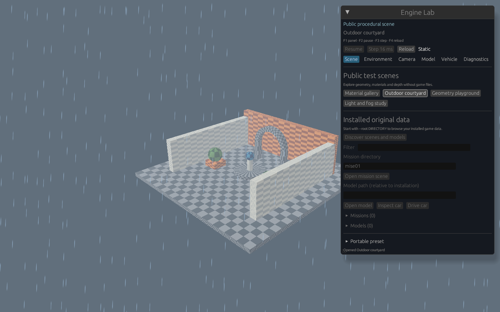

Native 1280 × 800 Linux software-Vulkan window capture.
Launch `--synthetic --lab`, select **Outdoor courtyard**, then **Rain** in
Environment. Geometry and textures are generated public fixtures; no game
installation is needed. Rain is a screen-space Lab preview. This capture does
not establish original-data gameplay or native macOS/Metal behavior.
